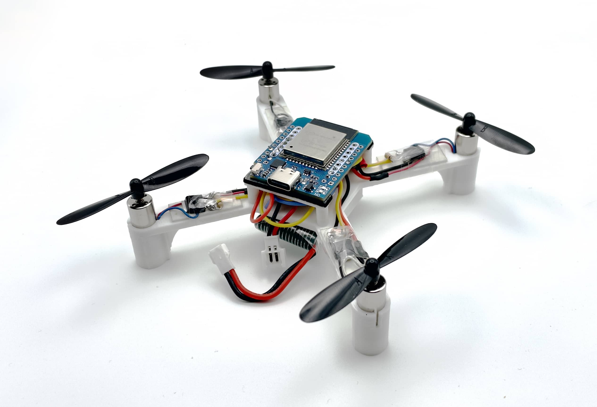
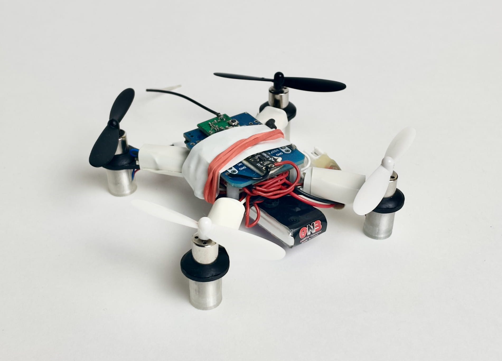
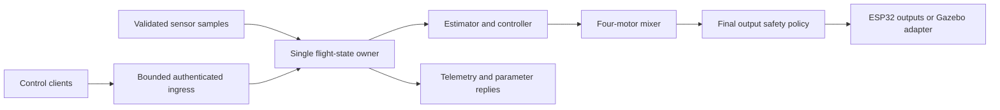
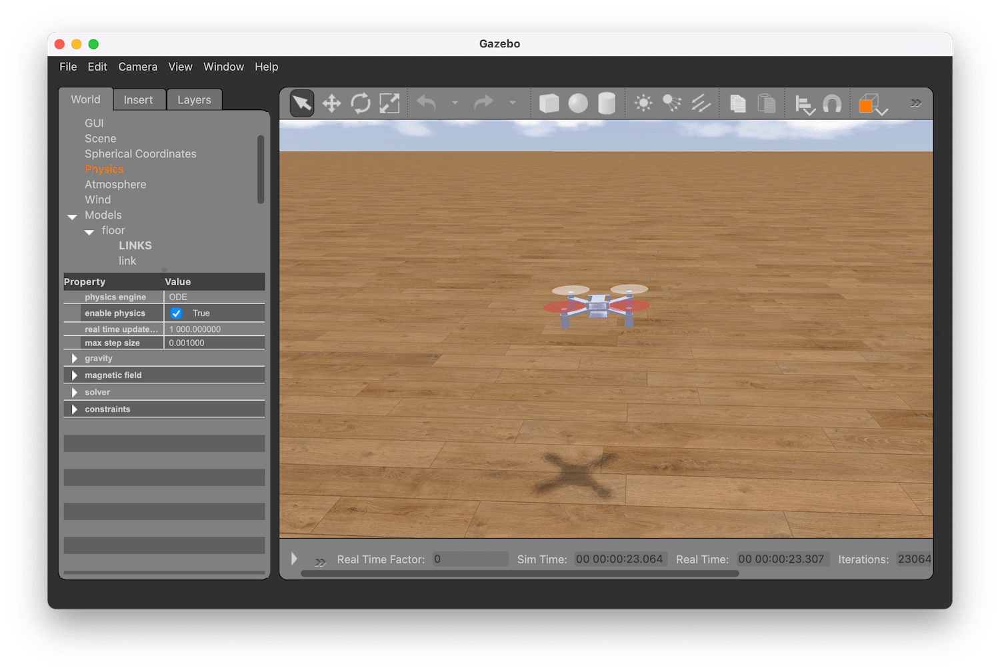
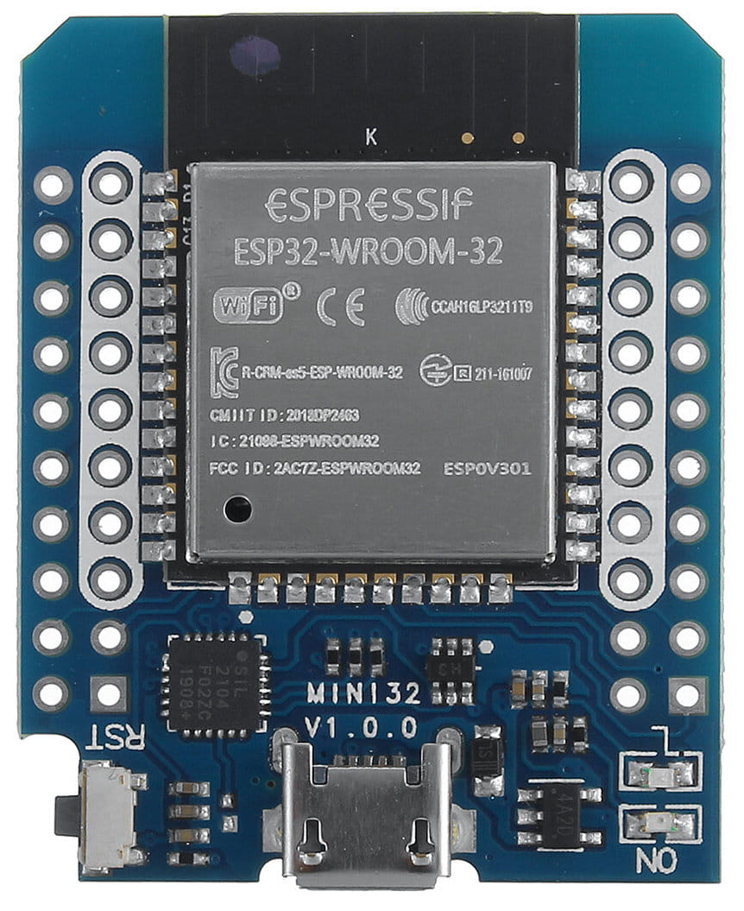
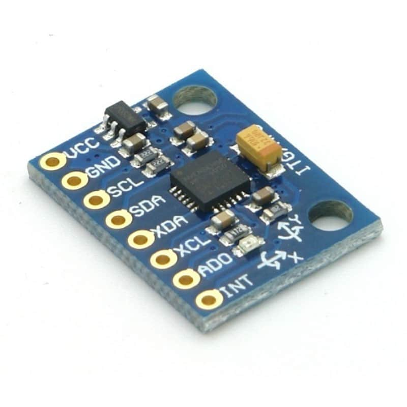

<!-- markdownlint-disable MD041 -->

<p align="center">
  <br>
  <strong>Flix RS</strong><br>
  A Rust flight controller for the Flix ESP32 quadcopter.<br>
  Deterministic control · Bounded communication · Gazebo simulation
</p>

<table>
  <tr>
    <th align="center">Original Flix 1.1 · 3D-printed frame</th>
    <th align="center">Original Flix · Version 0</th>
  </tr>
  <tr>
    <td></td>
    <td></td>
  </tr>
</table>

<p align="center">
  Hardware photographs from the original Flix project. Flix RS logo created for this repository.<br>
  <a href="docs/img/README.md">Asset provenance</a> · <a href="https://youtu.be/hT46CZ1CgC4">Original Flix flight demo</a>
</p>

Flix RS is an educational and research rewrite of [Flix](https://github.com/okalachev/flix). It combines a portable `no_std` control core with ESP32-S3 firmware integration, authenticated MAVLink 2 communication, host replay tools, and a browser-accessible Gazebo environment.

The GitHub repository is named `flix-rs`. Existing crate names, scripts, and Docker resources retain their `flight-*` and `flix-rust` names.

[Quick start](#quick-start) · [Simulation](#gazebo-simulation) · [Architecture](#architecture) · [Verification](#verification-status) · [Documentation](#documentation)

## Project status

**Development software; physical flight qualification is incomplete.** Firmware builds and simulation checks provide evidence for their stated workloads. They do not establish safe motor operation, target timing, radio reliability, or real flight behavior.

The checks cover 110 Rust and 56 Python tests, 8 Kani proofs, 6 fuzz targets, supply-chain checks, 20 Gazebo scenario runs and the paired C++/Rust comparison (passing on a soft-contact plant). GitHub Actions is on hold; the latest results are a local run on 2026-10-16. The QGroundControl operator checklist passes against the Rust owner in Gazebo; physical hardware qualification remains open.

See the [current status](docs/rust-rewrite/status.md) for the summary and evidence links. The [software acceptance report](docs/rust-rewrite/software-acceptance.md) records the 2026-10-05 state.

## Capabilities

- **Portable flight core:** attitude estimation, STAB/ACRO/AUTO control, PID control, motor mixing, and explicit lifecycle transitions.
- **Bounded execution:** one owner of flight state, bounded queues, and a flight tick without heap allocation.
- **Output safety:** source leases, sensor freshness, frame expiry, fault handling, and Stop priority through a final motor-output policy.
- **Authenticated communication:** a defined MAVLink 2 subset with signing, replay checks, telemetry, and a 96-parameter schema.
- **ESP32-S3 integration:** an MPU6050 driver and ESP-IDF adapters for sensor, output, storage, and transport boundaries.
- **Simulation and replay:** a Gazebo 11 adapter, finite acceptance scenarios, raw traces, host benchmarks, and pinned legacy comparisons.
- **Optional radio proxy:** a separate Rust application bridging native USB serial to an explicitly provisioned encrypted ESP-NOW peer.
- **Local delivery tooling:** verified software packages, source inventories, staged installation, and package rollback.

## Architecture

Validated commands and sensor samples enter a single Rust owner. The owner updates estimation and lifecycle state, selects the control intent, computes torque, and mixes motor commands. A final safety policy decides whether those commands may reach the output boundary.



The shared contract uses FLU coordinates and rear-left, rear-right, front-right, front-left motor order. Stop and fault transitions invalidate cached output frames. The SDK boundary also has an expiring motor-enable gate; its physical behavior requires instrumented verification.

| Component | Responsibility |
| --- | --- |
| [`crates/flight-core`](crates/flight-core) | Time, estimation, control, mixing, lifecycle, safety, SBUS, and log ring |
| [`crates/flight-protocol`](crates/flight-protocol) | MAVLink framing, signing, replay validation, ingress, and telemetry |
| [`crates/flight-config`](crates/flight-config) | Generated parameter schema, validation, persistence, and interrupted-write recovery |
| [`apps/esp32`](apps/esp32) | Flight owner integration, sensor driver, and ESP32-S3 firmware boundary |
| [`apps/proxy`](apps/proxy) | Serial / ESP-NOW bridge with bounded queues and Stop priority |
| [`apps/replay`](apps/replay) | Replay, benchmarks, loopback bench, and settings tools |
| [`adapters/gazebo`](adapters/gazebo) | Versioned C ABI and Gazebo plant integration |
| [`tools`](tools) | Python clients, browser viewer, scenario analysis, and acceptance tooling |

Flight logic is implemented in Rust. C and C++ remain at the ESP-IDF and Gazebo integration boundaries. Read the [architecture](docs/rust-rewrite/architecture.md) and [runtime decision](docs/rust-rewrite/adr-001-runtime.md) for ownership and boundary details.

## Quick start

### Prerequisites

- Rust through `rustup`; [`rust-toolchain.toml`](rust-toolchain.toml) pins the host toolchain to **1.92.0** with Clippy and rustfmt.
- Python 3, Git, Make, and a host C++ compiler for the consolidated checks.
- Docker for the documented Gazebo workflow.
- The pinned original Flix checkout for legacy comparisons and simulator assets.

Keep the two repositories beside each other:

```text
workspace/
├── flix/       # Original Flix at the reviewed revision
└── flix-rs/    # This repository
```

```sh
git clone https://github.com/senseix21/flix-rs.git
git clone https://github.com/okalachev/flix.git
git -C flix checkout 1f5b268271536e45a9377d1c5317d3eb6f3c3bba
cd flix-rs
```

If the legacy checkout is elsewhere, set `FLIX_LEGACY` for host comparisons. The Docker commands below explicitly mount `../flix`.

### Run and check the host software

```sh
# Deterministic demonstration
make demo

# Release build of the host workspace
make build

# Formatting, generation checks, Clippy, tests, replay, and ABI checks
make check
```

The consolidated check includes Python integration tests against a real loopback Rust owner, 400 scalar legacy comparisons, simulator ABI safety checks, and a host benchmark. It requires permission to open local sockets. Actual Gazebo physics scenarios run separately.

## Gazebo simulation

The supported workflow runs Gazebo 11 headlessly in Docker and exposes a local browser viewer. It uses the original Flix plant assets, including mass and motor geometry. It does not model or qualify a specific development board's electrical hardware.

<p align="center">
  <br>
  <em>Upstream Flix simulator screenshot. The Rust workflow below uses the Rust controller and its own browser viewer.</em>
</p>

### Start the world and viewer

From the repository root, with Docker running and the legacy Flix plant checkout available:

```sh
make sim
```

This builds the image if missing, starts the world and viewer, waits for a live
Gazebo pose, and opens http://127.0.0.1:8765. Keep the terminal open; Ctrl+C stops
both processes. Arming remains an explicit browser action. Startup times out
after ten minutes (excluding the initial image build).

Use `make sim-status`, `make sim-logs`, and `make sim-stop` from another terminal.
`make sim-build` explicitly rebuilds the image; `make help` lists commands.
The launcher manages only its own labeled `flix-rust-gazebo-browser` container.
Stop older manually launched simulations first if they hold UDP port 14550.

Apple Silicon selects the native arm64 development image; other hosts use the
existing default image. With Colima, start it using
`colima start --port-forwarder grpc` so UDP reaches the simulator.
The arm64 image is for development and is separate from the CI evidence image.
Plant assets are found in `.local/legacy-git` or `../flix`; override with
`make sim SIM_LEGACY=/path/to/flix`. See [legacy source](docs/legacy-source.md)
for the pinned plant revision. `SIM_IMAGE` and `SIM_PORT` override the image
and browser port. Both HTTP and published UDP bind only to host loopback.

### Swarm browser demo

```sh
make sim-swarm
```

Starts three drones, waits for all three live poses, and opens the viewer.
The existing coordinator automatically arms and flies a repeating demo; the
swarm browser is view only. Set the count with `make sim-swarm SWARM_DRONES=5`
(1–8). The image, plant path, and browser port options are the same as `make sim`.
Stop the current session with `make sim-stop` before switching between single
drone and swarm. `make sim-status` and `make sim-logs` work for either session;
Ctrl+C stops the viewer and world.

### Browser controls

Wait for **Ready**, press **Arm**, and increase **Thrust** gradually. Hold the direction buttons to steer.

| Control | Action |
| --- | --- |
| Arm / Disarm | Explicitly enable control / stop motor output |
| Thrust slider or ↑ / ↓ | Adjust thrust |
| W / A / S / D | Tilt |
| Q / E | Yaw |
| Space | Disarm |
| Reset drone | Stop control and restart the simulated world upright |
| Isometric / Top view / Reset view | Change the camera |

Drag to orbit and scroll to zoom. Keep the viewer focused and visible: leaving the page requests disarm, and lost input expires the browser control lease after 500 ms. **Reset drone** resets the whole world; **Reset view** only changes the camera.

Use one control client at a time. Browser controls are restricted to the localhost simulation and require the viewer session token and matching localhost Origin.

For terminal control, run the viewer with `--view-only`, then use a second terminal:

```sh
PYTHONPATH=tools python3 tools/gazebo-control.py
```

The terminal client uses its own key mapping: A arms, Space disarms, W/S adjusts thrust, I/K controls pitch, J/L controls roll, Q/E controls yaw, C clears a latched fault while stopped, and X exits and disarms.

### Run simulator acceptance checks

```sh
# Build/load the plugin and check parameter, arm, motor, and disarm behavior
make sim-check

# Run 20 isolated finite physics and failure scenarios
make sim-scenarios
```

Scenario inputs and thresholds are declared in [`fixtures/simulator/acceptance.json`](fixtures/simulator/acceptance.json). Results, logs, and per-tick traces are written under `.local/qualification/`. These checks run separately from the live viewer container. Dropped trace packets invalidate timing conclusions.

## ESP32-S3 firmware

<table>
  <tr>
    <th align="center">Original Flix ESP32 Mini</th>
    <th align="center">GY-521 / MPU6050 module</th>
  </tr>
  <tr>
    <td align="center"></td>
    <td align="center"></td>
  </tr>
</table>

These upstream component photographs are reference illustrations. The Rust firmware candidate targets ESP32-S3 with MPU6050; an ESP32 Mini photograph does not identify a supported Rust board or pin mapping.

The target integration uses **ESP-IDF v5.4.2** and **Xtensa Rust 1.88.0.0**. Activate the pinned `esp` toolchain and ESP-IDF environment before building:

```sh
sh scripts/build-esp32.sh
sh scripts/build-proxy.sh
```

Default PWM output is disabled and board pins are unassigned. An exact reviewed board profile, wiring, power system, and measured output behavior are required before hardware use. Build scripts do not flash devices.

A separate ARM check verifies portable `no_std` compilation:

```sh
rustup target add thumbv7em-none-eabihf
cargo check --manifest-path apps/esp32/firmware/Cargo.toml \
  --locked --release --target thumbv7em-none-eabihf
```

This establishes portability; it is not an ESP32 target build. Follow the [development runbook](docs/rust-rewrite/development-runbook.md), [qualification procedure](docs/rust-rewrite/qualification.md), and [proxy guide](apps/proxy/README.md) for target configuration, private provisioning, packaging, and recovery.

## Verification status

Current results; details in [current status](docs/rust-rewrite/status.md):

| Check | Result |
| --- | --- |
| Formatting, generated contracts, and Clippy | Passed |
| Rust / Python tests | 110 / 56 passed |
| Kani model-checking proofs | 8 passed |
| Fuzzing (6 targets) | No crashes |
| Supply chain (cargo-deny) | Passed |
| Legacy scalar oracle | 400 cases passed |
| Simulator ABI safety scenarios | 14 passed |
| Actual Gazebo scenarios | 20 runs passed on the soft-contact plant |
| ESP32-S3 SDK builds | Default flight, ESP-NOW flight, and proxy passed |
| QGroundControl v5.0.8 | Signed discovery and all 117 parameters; operator checklist (console, virtual joystick, arm, link cut, re-arm, disarm) passed in Gazebo over the unsigned development link |
| Clean source build, local package installation, and rollback | Passed |
| Paired C++/Rust plant comparison | Passed (stable-interval rule; 20/20 x86 pairs, worst 17.5 mm) |
| QGroundControl operator flow over the signed link | Open |
| Physical sensor, output, radio, timing, and flight qualification | Open |

The earlier comparison failure was caused by rigid ground-contact chatter in the simulator, not by the controller; see [plant parity](docs/rust-rewrite/evidence/plant-parity/README.md). No controller gains or limits were changed. Full-tick parity still differs at stick transitions by design.

## Documentation

| Document | Purpose |
| --- | --- |
| [Current status](docs/rust-rewrite/status.md) | Current verification, open gates and evidence links |
| [Software acceptance report](docs/rust-rewrite/software-acceptance.md) | 2026-10-05 measurements and delivery evidence (historical) |
| [Evidence index](docs/rust-rewrite/evidence/software-five/index.json) | Raw trace and log inventory with hashes |
| [Completion report](docs/rust-rewrite/completion-report.md) | Implemented scope and remaining gates |
| [Remaining plan](docs/rust-rewrite/remaining-plan.md) | Outstanding software and hardware work |
| [Architecture](docs/rust-rewrite/architecture.md) | Ownership, execution, and component boundaries |
| [Specification](docs/rust-rewrite-spec.md) / [phase plan](docs/rust-rewrite-plan.md) | Requirements and implementation sequence |
| [Protocol contract](docs/rust-rewrite/protocol.md) | Authentication, supported messages, and client behavior |
| [Compatibility](docs/rust-rewrite/compatibility.md) | Preserved behavior and intentional differences |
| [Development runbook](docs/rust-rewrite/development-runbook.md) | Build, package, install, and recovery procedures |
| [Acceptance matrix](docs/rust-rewrite/acceptance-matrix.md) | Requirement gates and verification scope |
| [Legacy review](docs/architecture-review.md) / [source provenance](docs/legacy-source.md) | Original design and immutable reference revision |

## Engineering and provenance

Changes follow [`AGENTS.md`](AGENTS.md): explicit ownership, bounded work, measurable acceptance criteria, preserved safety contracts, and factual reporting of verification limits. Read the relevant implementation and specification before changing flight behavior.

The original Flix design is credited to [its upstream project](https://github.com/okalachev/flix). The reviewed baseline is revision `1f5b268271536e45a9377d1c5317d3eb6f3c3bba`. Legacy assets and reference material retain their upstream provenance; consult the [source record](docs/legacy-source.md) before redistributing them.

## License

The original work in this repository is licensed under the [Apache License 2.0](LICENSE). Upstream Flix publishes no licence, so the upstream images in `docs/img/` and the derived Flix RS wordmark are **not** covered; see [`NOTICE`](NOTICE).
