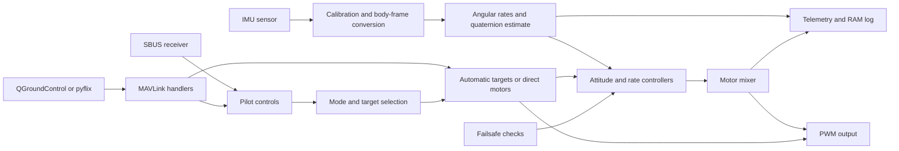

# Flix Embedded Architecture Review

Review date: 2026-10-05. Repository revision: `1f5b268`.

This report describes the legacy C++ Flix repository, not the implementation status of flix-rust. See [source provenance](legacy-source.md).

This review covers the application source in the repository: all firmware modules and math helpers, Gazebo plugin and compatibility headers, simulator world and drone model, Python client and utilities, ESP-NOW proxy, CSV conversion tools, build files, CI workflows, editor configuration, and documentation support code. Mechanical meshes, photographs, and external dependency implementations were not audited. Findings describe the checked-out source; upstream libraries and live hosted metadata were not fetched.

The review combines static inspection with a small host executable using the actual control, safety, and timing sources. It does not establish hardware timing, sensor reliability, radio performance, or flight performance. This report records findings and proposed work; it does not modify flight behavior.

## Architectural assessment

Flix is a compact educational flight controller with a coherent control pipeline and useful simulation and analysis tools. Its strongest architectural choice is that the simulator compiles substantial parts of the real firmware. The code is small enough to follow end to end, and units, coordinate conversions, controller stages, and motor ordering are generally visible.

The main weakness is that safety is distributed across shared variables and control stages. Some command paths bypass the assumptions of other stages, and there is no final motor-output boundary that independently enforces disarming and command freshness. This produces a reproduced case where a disarmed drone retains nonzero direct motor outputs. Input validation and bounded execution also need attention before extending autonomous control or relying on the firmware for more demanding hardware use.

The appropriate next step is to strengthen safety and execution contracts inside the existing small architecture. A large framework migration or additional tasks would not by itself fix these failures.

## Repository responsibilities

| Area | Responsibility | Main entry points |
| --- | --- | --- |
| `flix/` | Firmware, estimation, control, motor output, communication, configuration | `flix.ino`, `control.ino`, `mavlink.ino` |
| `gazebo/` | Physics simulation, reuse of firmware, substitutes for hardware APIs | `simulator.cpp`, `Arduino.h`, `flix.h` |
| `tools/pyflix/` | Host API for telemetry, commands, parameters, automatic setpoints | `flix.py`, `proxy.py` |
| `tools/espnow-proxy/` | USB serial to ESP-NOW bridge | `espnow-proxy.ino` |
| Other `tools/` | Log extraction, plotting, metadata validation, format conversion | `log.py`, `metadata.py`, CSV converters |
| `docs/` | Hardware assembly, usage, theory, mdBook publishing | `usage.md`, `firmware.md`, `book.toml` |
| Root build and CI | Board builds, simulator integration, package and documentation checks | `Makefile`, `.github/workflows/` |

There is no position or velocity controller in this revision. The corresponding Python methods raise `NotImplementedError`. `AUTO` accepts externally supplied attitude, body-rate, or direct motor targets; it is not a complete onboard navigation or mission system.

## Runtime architecture

### Startup and scheduling

[`flix.ino`](https://github.com/okalachev/flix/blob/1f5b268271536e45a9377d1c5317d3eb6f3c3bba/flix/flix.ino) initializes the console, parameters, power, LED, motors, wireless link, IMU, and RC receiver. Parameters load before peripheral initialization so stored pin assignments and defaults can influence setup.

The application follows a cooperative Arduino loop:

```text
readIMU -> step -> readRC -> estimate -> control -> sendMotors
        -> handleConsole -> processMavlink -> readVoltage
        -> logData -> syncParameters -> repeat
```

`readIMU()` waits for a new sensor sample. The sensor is configured for approximately 1 kHz, so sensor availability paces the nominal control rate. This is not a measured execution deadline. IMU waiting, console work, packet handling, telemetry, and flash operations all contribute to loop duration.

The application does not create separate flight-control tasks. The ESP32 Arduino runtime and wireless libraries have their own underlying tasks, so application-level sequential execution does not imply that every platform component runs on one thread.

MAVLink input is processed after the current motor update. A received command normally influences the next control iteration. RC is read before control, while MAVLink manual input can overwrite the shared pilot inputs later in the same iteration. There is no explicit priority or ownership policy when both inputs are active.

### Data and ownership



The direct arrow from automatic targets to PWM represents the direct actuator mode that bypasses the controller and mixer. Its interaction with safety is the highest-priority finding in this report.

State is shared through global variables, `extern` declarations, and pointer-based parameter and log registries. This keeps the source compact, but permits the console, RC receiver, MAVLink handlers, failsafes, and controller to change overlapping state without an explicit transition contract.

| State | Meaning | Main producers |
| --- | --- | --- |
| `gyro`, `acc` | Body-frame angular velocity and acceleration | IMU acquisition and calibration |
| `rates`, `attitude`, `landed` | Filtered rates, orientation estimate, ground heuristic | Estimator |
| `controlRoll/Pitch/Yaw/Throttle/Mode`, `controlTime` | Pilot inputs and last pilot update | RC and MAVLink manual control |
| `mode`, `armed` | Flight mode and arming state | Pilot gestures, console, MAVLink, failsafes |
| `attitudeTarget`, `ratesTarget`, `ratesExtra` | Orientation and rate targets | Mode interpreter and MAVLink |
| `torqueTarget`, `thrustTarget`, `motors` | Controller outputs and motor demands | Controllers, failsafes, direct actuator commands |
| `t`, `dt` | Floating-point seconds and step interval | Time module |

### Estimation

[`imu.ino`](https://github.com/okalachev/flix/blob/1f5b268271536e45a9377d1c5317d3eb6f3c3bba/flix/imu.ino) uses the external FlixPeriph library to create a sensor on SPI or I²C, select sensor ranges and sampling, wait for data, and read gyro and acceleration. It applies acceleration bias and scale, gyro bias, and sensor-to-body rotation. Gyro bias adaptation runs after the estimator has considered the vehicle landed for two seconds. Because this uses the previous iteration's `landed` value and a motor/gravity heuristic, it is not an independent proof of stationarity.

[`estimate.ino`](https://github.com/okalachev/flix/blob/1f5b268271536e45a9377d1c5317d3eb6f3c3bba/flix/estimate.ino) filters gyro readings and integrates them into a quaternion. Accelerometer gravity correction is applied only when motors are inactive and measured acceleration magnitude is close to gravity. During flight, a weak correction assumes the vehicle is approximately level.

This is a deliberately small estimator. It has no independent in-flight heading measurement, position estimate, altitude estimate, uncertainty calculation, or explicit sensor-health state. Sustained tilted flight can conflict with the level assumption; real yaw depends on gyro integration. These limits matter when choosing autonomous maneuvers.

### Control and motor output

[`control.ino`](https://github.com/okalachev/flix/blob/1f5b268271536e45a9377d1c5317d3eb6f3c3bba/flix/control.ino) interprets inputs, runs failsafes, computes attitude control, computes rate control, and mixes torque and thrust into four motors.

| Mode | Input interpretation | Active controller stages |
| --- | --- | --- |
| `RAW` | Sticks become scaled torque demand | Mixer |
| `ACRO` | Sticks become angular-rate demand | Rate PID and mixer |
| `STAB` | Roll/pitch become tilt targets; yaw adds rate input | Attitude controller, rate PID, mixer |
| `AUTO` | External attitude, rates, or motor demands | Depends on supplied target |

Invalid targets are represented with `NaN` and used to skip stages. This mechanism allows several control paths, but also makes invalid data and intentional bypass share the same representation.

The rate PID includes a filtered derivative and a limit on the integral contribution. The stored integral itself can continue growing while its output is clamped; it is not a full saturation-aware anti-windup mechanism. Updates reset integral and derivative after gaps outside the accepted timing interval.

The mixer adds signed roll, pitch, and yaw torque to collective thrust. Desaturation shifts all outputs to prioritize attitude over collective thrust. A common shift cannot fit outputs into `[0, 1]` if their span exceeds one; hardware conversion applies the final clamp. The simulator applies raw motor values to forces, so saturation behavior differs between targets.

Motor order is rear-left, rear-right, front-right, front-left. Internally the code uses FLU coordinates: front, left, up. MAVLink attitude, rate, and IMU handlers invert the appropriate Y/Z components for FRD coordinates. Changes to these signs must be reviewed across firmware, Python, and simulation together.

### Safety and power

[`safety.ino`](https://github.com/okalachev/flix/blob/1f5b268271536e45a9377d1c5317d3eb6f3c3bba/flix/safety.ino) provides three behaviors: reduce thrust after pilot input loss, allow pilot movement to interrupt automatic flight when a mode switch is not mapped, and disarm on excessive tilt in `STAB` mode. Loss response sets `AUTO`, requests level attitude, and reduces thrust over time. It does not measure altitude or guarantee a controlled landing.

There is no dedicated timestamp for automatic setpoints, no common arming validation, and no final safety arbiter for motor demands. Console arming directly sets `armed`; the MAVLink arming command checks low pilot throttle; automatic commands derive arming from their requested thrust or motors.

[`power.ino`](https://github.com/okalachev/flix/blob/1f5b268271536e45a9377d1c5317d3eb6f3c3bba/flix/power.ino) disables the configured brownout reset bit and optionally samples battery voltage at 10 Hz. Voltage is filtered and published, but there is no firmware low-voltage flight action. Whether brownout handling is appropriate must be established for each actual board and power circuit.

### Communications, parameters, and observability

[`wifi.ino`](https://github.com/okalachev/flix/blob/1f5b268271536e45a9377d1c5317d3eb6f3c3bba/flix/wifi.ino) provides AP, station, ESP-NOW, and disabled modes. The default AP is `flix` with password `flixwifi`. UDP uses port 14550 in both directions by default. Telemetry is broadcast initially and after the link appears stale, otherwise it follows a learned remote IP. The remote IP is updated before validating that a datagram contains a legitimate MAVLink sender.

MAVLink carries heartbeats, attitude, raw RC channels, motor demands, IMU measurements, battery information, parameter operations, shell traffic, and logs. Default rates are 2 Hz for slow telemetry, 20 Hz for attitude, 10 Hz for RC and motors, and 15 Hz for IMU. A finite `mavlinkTime` enables full telemetry; the code does not clear it after disconnect, so that is not a complete connection-state machine.

[`parameters.ino`](https://github.com/okalachev/flix/blob/1f5b268271536e45a9377d1c5317d3eb6f3c3bba/flix/parameters.ino) exposes 96 registered parameters. Each entry points directly to an integer or float. Setup captures board defaults, then loads stored float values from Preferences. Selected changes invoke peripheral setup callbacks immediately. Once per second, changed values are saved when no motor output is active, which usefully avoids ordinary parameter flash writes during flight. Wireless credential commands use direct string writes and do not share that protection.

[`log.ino`](https://github.com/okalachev/flix/blob/1f5b268271536e45a9377d1c5317d3eb6f3c3bba/flix/log.ino) holds 1,000 records at 100 Hz with 14 float columns: 56,000 bytes of sample storage. It records while armed, overwrites old entries, and offers text or MAVLink extraction. This is a nominal ten-second history; timing delays reduce achieved sampling. The ring write position is private to the writer and extraction emits physical array order; host scripts sort by timestamps. The transfer has no snapshot, missing-record recovery, or schema negotiation.

## Simulator architecture and fidelity

[`simulator.cpp`](https://github.com/okalachev/flix/blob/1f5b268271536e45a9377d1c5317d3eb6f3c3bba/gazebo/simulator.cpp) includes the real control, estimation, safety, logging, parameter, power, RC, timing, console, and MAVLink source. It supplies simulated sensor globals and hardware substitutes. It implements its own startup and update ordering rather than calling the firmware's `setup()` and `loop()`.

The world steps at 1 ms. The drone model has a 65 g body, specified inertia, a 1 kHz IMU, and simple sensor noise. The plugin applies scaled thrust at four arm positions and opposing yaw torques, including fixed motor asymmetry. SDL joystick axes substitute for SBUS channels; POSIX UDP substitutes for Wi-Fi; a file beside the plugin substitutes for Preferences.

Important differences from hardware:

* Real IMU acquisition, bus errors, calibration, interrupts, and driver waits are bypassed.
* Estimated yaw is overwritten with true model yaw every update. Simulation therefore cannot expose real gyro heading drift.
* Battery voltage is fixed at 4.2 V. Power droop and brownout behavior are absent.
* Motor forces use raw demands, bypassing the hardware clamp and PWM conversion.
* Commands are processed before motor forces in simulation and after PWM output in firmware.
* Wireless modes, encryption, RF loss, hardware setup, and LED behavior are mocked.
* Simulation delays combine wall-clock sleeps with additions to the emulated clock; this differs from IMU-driven hardware timing.
* Shared globals mean the plugin is effectively designed for one drone instance. Multiple instances would share firmware state and the socket.

The simulator is valuable for controller and protocol integration, but its current test success does not establish equivalence at safety, timing, sensor, or output boundaries.

## Python and support tools

[`tools/pyflix/flix.py`](https://github.com/okalachev/flix/blob/1f5b268271536e45a9377d1c5317d3eb6f3c3bba/tools/pyflix/flix.py) opens a MAVLink connection, starts a reader thread and heartbeat thread, stores recent messages, converts telemetry to FLU, and dispatches callbacks. It offers command, parameter, console, attitude, rate, motor, and pilot-control methods. Default connection listens on port 14550, falling back to 14555 when the former is occupied; this fallback assumes a proxy is already running.

The UDP proxy fans telemetry to QGroundControl on 14560 and pyflix on 14555, forwarding their commands to the latest source endpoint. It tracks one source, so it is not a multi-vehicle router. The ESP-NOW proxy discovers peers, creates serial links, and forwards parsed MAVLink frames from USB to peers and received bytes back to USB.

Support scripts download logs over MAVLink or serial, plot frequency content, convert CSV to MCAP or ULog, verify parameter metadata, and check editor include paths. The metadata check confirms every firmware parameter is described, but does not require every metadata entry to exist in firmware. Older notch-filter, telemetry, and logging parameter descriptions remain in the metadata.

The documentation site uses mdBook, an alert preprocessor, image zoom, and a Three.js rotation illustration. These are presentation helpers, independent of flight operation. The alert preprocessor only visits top-level chapters, so nested chapters need traversal if alerts are added there.

## Findings and priorities

Priorities describe engineering order: **P0** is an immediate safety correction; **P1** is required hardening of command, timing, or fault handling; **P2** improves fidelity, reliability, and maintainability. Static findings below identify the code consequence without claiming a measured hardware incident.

### F01 — P0: Disarming does not reliably stop direct motor control

Evidence: [`controlTorque()`](https://github.com/okalachev/flix/blob/1f5b268271536e45a9377d1c5317d3eb6f3c3bba/flix/control.ino#L106) returns when `torqueTarget` is invalid before checking `armed`. [`SET_ACTUATOR_CONTROL_TARGET`](https://github.com/okalachev/flix/blob/1f5b268271536e45a9377d1c5317d3eb6f3c3bba/flix/mavlink.ino#L219) invalidates all controller targets and directly copies motor values. `sendMotors()` does not independently check arming state.

Consequence: after direct motor control, a console or MAVLink disarm can leave the previous motor outputs in place. A failsafe that changes attitude and thrust also cannot update these outputs while the torque target remains invalid.

Host reproduction using actual source retained `motors[0] = 0.40` with `armed = false`. It also retained that output after the RC-loss response reduced the thrust target.

Required change: enforce disarming and a safe output policy at the final motor boundary, regardless of target validity or controller bypass. Test every command path and transition into and out of direct output.

### F02 — P1: Automatic commands have no freshness contract

Evidence: [`rcLossFailsafe()`](https://github.com/okalachev/flix/blob/1f5b268271536e45a9377d1c5317d3eb6f3c3bba/flix/safety.ino#L20) compares `t - controlTime` against a timeout. `controlTime` starts as `NaN`; only RC and manual control update it. Automatic setpoint handlers do not update a dedicated timestamp.

Consequence: an automatic session without prior pilot input never satisfies the timeout comparison. A session with an old pilot timestamp can trigger descent despite fresh automatic setpoints. Heartbeats do not prove a current control setpoint, and RC and wireless manual input can overwrite one another without arbitration.

The host probe confirmed that an armed automatic state with `controlTime = NaN` retained its thrust target indefinitely for the tested timeout check.

Required change: explicitly select the control source, record accepted setpoint time per source, and define loss behavior for pilot, attitude, rate, and direct motor control. Define which commands require continuous refresh.

### F03 — P1: Parameter and command validation is incomplete

Evidence: [`setParameter()`](https://github.com/okalachev/flix/blob/1f5b268271536e45a9377d1c5317d3eb6f3c3bba/flix/parameters.ino#L180) checks only that integer values are finite. It does not enforce ranges, cross-field validity, board capability, or an armed-state restriction. Startup also assigns stored values directly. [`normalizeRC()`](https://github.com/okalachev/flix/blob/1f5b268271536e45a9377d1c5317d3eb6f3c3bba/flix/rc.ino#L36) indexes arrays from configurable channel numbers and divides by calibration span.

Consequence: an index of 16 or greater can access outside the RC array; equal calibration endpoints divide by zero. Invalid PWM resolution or frequency, acceleration scale, mode mapping, filter weights, or safety time constants can propagate into control and peripheral code. Metadata hints in QGroundControl do not protect the firmware boundary. Callbacks can reconfigure PWM while armed; replacing a pin does not explicitly detach and stop the previous output pin.

Required change: validate each parameter in firmware, validate dependent combinations, check stored configuration on boot, and permit hardware reconfiguration only in an explicitly safe state. Share arming preconditions across gestures, console, MAVLink, and automatic commands.

### F04 — P1: Maintenance commands can suspend the flight loop

Evidence: [`pause()`](https://github.com/okalachev/flix/blob/1f5b268271536e45a9377d1c5317d3eb6f3c3bba/flix/console.ino#L85) continues time, console, and MAVLink processing but does not run estimation, control, failsafes, or ordinary motor updates. Calibration, motor tests, parameter-list replies, log dumps, and full log transfer execute synchronously. `doCommand()` has no general disarmed-state gate. Wi-Fi credential changes write flash immediately.

Consequence: accepted commands can leave PWM running while safety and control stop progressing. `pause()` supports nested console and MAVLink dispatch, allowing reentrant commands. Unbounded serial input and a growing MAVLink print buffer add allocation and execution pressure. A log request sends all 1,000 records in one handler.

Required change: reject maintenance commands while flight outputs are active, bound input and output buffers, and service large transfers in a limited number of records or bytes per iteration. Preserve control deadlines under legitimate telemetry and command traffic.

### F05 — P1: IMU failure is not a defined flight state

Evidence: [`setupIMU()` and `readIMU()`](https://github.com/okalachev/flix/blob/1f5b268271536e45a9377d1c5317d3eb6f3c3bba/flix/imu.ino#L29) use the created sensor without application-level null or initialization-success handling, wait for data, and consume samples without an explicit freshness check. Sensor status is printed by a diagnostic command, not used by a common output safety policy.

Consequence: behavior under absent sensors, initialization failure, stale samples, or a stalled wait depends on external FlixPeriph behavior. The repository does not establish a bounded wait or deterministic motor response to these faults. NaN propagation can interact with controller-stage skipping and preserve previous outputs.

Required change: inspect the pinned driver implementation, bound acquisition, expose sensor-health and sample age, and define an output response for lost or invalid state. Also verify the allocation contract: `free(imu)` should not be assumed correct for an object created by an external C++ factory.

### F06 — P1: MAVLink field handling contains unsafe edge cases

Evidence: [`handleMavlink()`](https://github.com/okalachev/flix/blob/1f5b268271536e45a9377d1c5317d3eb6f3c3bba/flix/mavlink.ino#L110) copies parameter identifiers using string functions although fixed-size protocol fields may lack termination. Indexed parameter reads use `memcpy(..., 16)` from `getParameterName()`, including the empty string returned for an invalid index. Shell input passes unvalidated `m.count` as the destination size to `strlcpy()` rather than validating it against the local array and protocol field.

Consequence: malformed or boundary-case packets can cause invalid reads, inconsistent strings, truncation, or writes outside the intended buffer contract. The exact behavior of zero-length and oversized counts depends on the target string implementation. An invalid parameter index certainly does not provide a 16-byte source object.

Required change: validate counts and indices first, copy explicit bounded field lengths, and append termination locally. Test zero count, maximum count, excessive count, nonterminated identifiers, and negative/out-of-range parameter indices with memory sanitizers on a host parser harness.

### F07 — P1: Accepted setpoints do not enforce the complete protocol contract

Evidence: attitude handlers accept quaternions and body rates without normalization or finite-value validation. Only the attitude-ignore bit is used to select a path; the other ignore bits are not fully implemented. Firmware manual controls are not clamped or validated, including protocol sentinel values. Direct motor demands are copied without firmware range checks.

Consequence: callers other than pyflix can bypass its validation. Invalid inputs can destabilize estimates and targets or produce differing behavior on hardware and in simulation. The motor telemetry handler also declares eight floats and initializes only the first four before packing all eight; unused values contain indeterminate stack data. It passes the millisecond variable to the actuator message's microsecond timestamp field.

Required change: define supported masks, reject unsupported combinations, validate all finite values and bounds, normalize accepted quaternions, zero unused telemetry fields, and use explicit timestamp units.

### F08 — P1: Wireless control authority is implicit

Evidence: the code handles valid MAVLink messages based mainly on destination system ID, without configured sender authorization or application-managed signing verification. UDP learns the remote IP before message validation. The AP password is a shared default. ESP-NOW encryption is optional.

Consequence: another sender with access to the control transport can issue parameters, shell commands, arming, or motor targets, or redirect the learned telemetry destination. MAVLink system IDs identify vehicles; they do not authenticate senders.

Required change: define a trusted control endpoint or verified signing policy, restrict dangerous commands by state and sender, learn endpoints only after authorization, and require deployment-specific wireless credentials. RF pairing and encrypted ESP-NOW library behavior need separate validation.

### F09 — P2: Time representation degrades and rollback stalls rate limiters

Evidence: [`step()`](https://github.com/okalachev/flix/blob/1f5b268271536e45a9377d1c5317d3eb6f3c3bba/flix/time.ino#L10) converts absolute `micros()` to float seconds and subtracts floating-point values. [`Rate`](https://github.com/okalachev/flix/blob/1f5b268271536e45a9377d1c5317d3eb6f3c3bba/flix/util.h#L71) uses absolute float differences. Nonpositive `dt` becomes zero, but stored rate timestamps are not repaired on a clock rollback.

Consequence: floating-point precision changes with uptime. At one hour, the host arithmetic check represented an intended 1 ms interval as `0.0009765625` seconds. The probe showed a rate limiter refusing to run after time fell from 4294 seconds to 0.001 seconds. If the target exposes wrapping 32-bit microseconds, rollover occurs at approximately 71.6 minutes; confirm that property in the actual core before treating it as a board-specific observed fault.

Required change: compute elapsed time from integer ticks with an explicit rollover policy, convert deltas to seconds, handle long gaps deliberately, and track maximum loop duration and missed deadlines rather than only average loop rate.

### F10 — P2: Simulation and testing omit the highest-risk boundaries

Evidence: simulation corrects yaw from ground truth, bypasses sensor drivers, applies unclamped motors, and uses a different scheduling sequence. [`tools/test.py`](https://github.com/okalachev/flix/blob/1f5b268271536e45a9377d1c5317d3eb6f3c3bba/tools/test.py) contains one integration test covering connection, initial telemetry, console, a parameter update, mode changes, and basic command errors.

Consequence: current automated assertions do not cover direct motor disarm, setpoint loss, malformed packets, IMU faults, saturation, timing rollover, or actual flight response. Existing workflows define these builds and tests, but this review did not query their execution status.

Required change: add deterministic host tests for safety and protocol boundaries, then fault injection and hardware tests. Make the simulator use the same final validated motor demand as hardware, and make ground-truth yaw correction a clearly selectable mode.

### F11 — P2: Python request handling has response and lifecycle races

Evidence: command, parameter, and console methods send before registering their waiter. `wait()` only observes future callbacks. User callbacks run synchronously on the reader thread, and there is no explicit close method for the connection, threads, and timer. `_connected()` creates and starts a new `Timer` for every accepted message; reader and heartbeat loops have no shutdown contract.

Consequence: fast replies can be missed, producing avoidable retries or failures. A callback that performs a blocking request can block the reader needed to deliver its reply. Slow callbacks delay all reception. Repeated connection construction retains background work, while timer creation scales with packet rate. Connection writes and listener changes occur across threads without an explicit synchronization contract.

Required change: register request completion before sending, serialize or correlate outstanding requests, keep receive dispatch nonblocking, provide `close()` and context-manager support, and use one monotonic connection deadline. Use mocks to test immediate replies, disconnect/reconnect, callback behavior, and shutdown.

### F12 — P2: Logs and conversion tools need explicit limits

Evidence: log extraction reads a live ring without snapshot or recovery. The ULog converter uses a fixed `float values[30]` and loops over all input columns without a size check. Serial extraction assumes output exists and a log directory is present. FFT analysis infers a uniform sample rate from total duration.

Consequence: more than 30 non-timestamp CSV columns can overwrite the converter's local storage. Missing or duplicated radio records are accepted without completeness reporting. Irregular sampling can make the FFT interpretation misleading, and empty input is not handled consistently.

Required change: bound converter schemas and input sizes, validate empty or malformed logs, snapshot extraction only in a safe state, report missing offsets, and check sampling uniformity before spectral analysis.

### F13 — P2: ESP-NOW proxy discovery has resource and callback concerns

Evidence: discovery allocates links and appends raw pointers to a shared vector; the main loop traverses that vector. There is no explicit peer cap, removal, callback-to-loop handoff, or failure policy. A stored key is copied with `strcpy()` into a fixed array, and key generation uses `random()` without demonstrating a cryptographic entropy source.

Consequence: repeated discovery and failed link setup can retain resources. The callback and main-loop ownership contract is not explicit; whether concurrent access is possible depends on the external SDK callback context. A malformed stored key can exceed the local buffer. The key's unpredictability is not established by the repository.

Required change: validate stored key length, use a documented secure random source when secrecy is required, bound peers, and transfer discovery events to one owner. Verify callback context and library peer lifecycle before changing threading behavior.

### F14 — P2: Build reproducibility and metadata checks are partial

Evidence: the ESP32 core is pinned to 3.3.10 and MAVLink to 2.0.33; FlixPeriph and Python runtime packages are not pinned. `.core` and `.libs` are marker files rather than verified installed versions. The metadata script checks source-to-metadata coverage and then depends on hosted HTTP resources. The simulator relies on fixed user Arduino library locations and legacy Gazebo setup.

Consequence: two fresh builds can obtain different driver or Python behavior. Existing marker files can conceal a toolchain change. Hosted metadata availability can fail a local consistency check. Extra metadata entries can advertise unavailable parameters.

Required change: record validated dependency versions, verify effective toolchain state, split offline metadata consistency from hosted publication checks, and document a reproducible simulator environment. Keep this proportional to the repository's educational scope.

## Verification performed

| Check | Result | Limit |
| --- | --- | --- |
| Firmware, simulator, tool, build, and documentation-source inspection | Completed | External dependency internals excluded |
| Host C++ probe including actual `control.ino`, `safety.ino`, `time.ino`, math helpers, and Gazebo Arduino shim | Completed; reproduced F01, the unset timestamp part of F02, and rate rollback in F09 | Controlled globals; no radio, sensor, or PWM hardware |
| Python AST parsing | All 13 repository Python files parsed | Syntax only; no runtime dependency or connection validation |
| Local parameter metadata coverage | All 96 registered parameters described | Extra metadata entries remain; hosted files not checked |
| Local metadata CRC calculation | General `2566517357`; parameters `3307474483` | Values match local references; no hosted verification |
| Firmware board builds | Not run | Arduino CLI unavailable in this environment |
| Gazebo integration test | Not run | `gzserver` unavailable in this environment |
| Markdown lint | Not run | `markdownlint-cli2` unavailable in this environment |

The host probe compiled with C++17 and the repository's `gazebo/` and `flix/` include paths. Clang reported the existing variable-length array extension in `splitString()`. The relevant reproduced outputs were:

```text
Disarmed + invalid torque: motor remains 0.40
AUTO + unset controlTime: thrust remains 0.60
Direct output + expired controlTime: target 0.5999, motor 0.40
Rate after clock rollback: blocked (last=4294.0, now=0.001)
```

The first reproduction can be repeated in a host harness including the control source by setting `armed = false`, invalidating `torqueTarget`, setting each motor to `0.4f`, and calling `controlTorque()`. The loss reproduction sets `mode = AUTO`, `armed = true`, `t = 20`, `controlTime = NAN`, and `thrustTarget = 0.6f`, then calls `rcLossFailsafe()`. No physical motor operation was performed.

## Recommended architectural work

### First: establish one motor safety boundary

Every output path should reach one function that validates arming, control freshness, state validity, and normalized motor bounds. Direct actuator mode must pass through it. A disarm transition must produce safe outputs independently of target representation. Decide how that function responds to invalid data, and test that decision for each flight mode.

Use an explicit control-kind field to distinguish attitude, rates, torque, and direct motors. Keep invalid numerical data separate from intentional stage selection. Preserve the small controller functions and sequential pipeline.

### Second: make control authority and maintenance rules explicit

Represent the selected input source and its last accepted setpoint time. Define takeover, mode transitions, timeout behavior, and common arming checks. Gate calibration, peripheral reconfiguration, log transfer, and credential writes on a safe state. Validate parameters and protocol fields before mutating flight state.

### Third: prove the execution budget and fault responses

Measure acquisition, control, telemetry, command handling, and worst loop duration on each supported board. Establish bounded sensor waiting and bounded communication work. Record deadline misses and sensor faults. Pin and inspect the driver version used for these measurements.

### Fourth: strengthen tests and simulator parity

| Boundary | Required cases |
| --- | --- |
| Motor safety | Disarm from every mode; invalid targets; direct-output timeout; explicit stop |
| Control source | No initial input; stale pilot; stale AUTO setpoint; fresh heartbeat without setpoint; takeover |
| Parameters and packets | Array limits; bad calibration spans; invalid PWM settings; NaN/Inf; field counts and masks |
| Timing and sensors | Long gap; clock rollback/rollover; missing/stale IMU; initialization failure |
| Host client | Immediate ACK; concurrent requests; slow callback; disconnect; deterministic cleanup |
| Simulation | Same output clamp; optional heading drift; consistent update order; repeatable reset |

Only after these contracts are established should position control, velocity control, more sensor types, or additional concurrency be added. New capability should have a clear source of state, an output constraint, a loss policy, and a measurable acceptance test.

## Suggested reading order

Read [`flix.ino`](https://github.com/okalachev/flix/blob/1f5b268271536e45a9377d1c5317d3eb6f3c3bba/flix/flix.ino) for execution order, then [`imu.ino`](https://github.com/okalachev/flix/blob/1f5b268271536e45a9377d1c5317d3eb6f3c3bba/flix/imu.ino) and [`estimate.ino`](https://github.com/okalachev/flix/blob/1f5b268271536e45a9377d1c5317d3eb6f3c3bba/flix/estimate.ino) for state generation. Follow [`control.ino`](https://github.com/okalachev/flix/blob/1f5b268271536e45a9377d1c5317d3eb6f3c3bba/flix/control.ino), [`safety.ino`](https://github.com/okalachev/flix/blob/1f5b268271536e45a9377d1c5317d3eb6f3c3bba/flix/safety.ino), and [`motors.ino`](https://github.com/okalachev/flix/blob/1f5b268271536e45a9377d1c5317d3eb6f3c3bba/flix/motors.ino) for how inputs become physical outputs. Read [`mavlink.ino`](https://github.com/okalachev/flix/blob/1f5b268271536e45a9377d1c5317d3eb6f3c3bba/flix/mavlink.ino), [`wifi.ino`](https://github.com/okalachev/flix/blob/1f5b268271536e45a9377d1c5317d3eb6f3c3bba/flix/wifi.ino), and [`parameters.ino`](https://github.com/okalachev/flix/blob/1f5b268271536e45a9377d1c5317d3eb6f3c3bba/flix/parameters.ino) for external influence on that pipeline. Finish with [`simulator.cpp`](https://github.com/okalachev/flix/blob/1f5b268271536e45a9377d1c5317d3eb6f3c3bba/gazebo/simulator.cpp), [`pyflix/flix.py`](https://github.com/okalachev/flix/blob/1f5b268271536e45a9377d1c5317d3eb6f3c3bba/tools/pyflix/flix.py), and the CI workflows to understand the development and verification loop.
