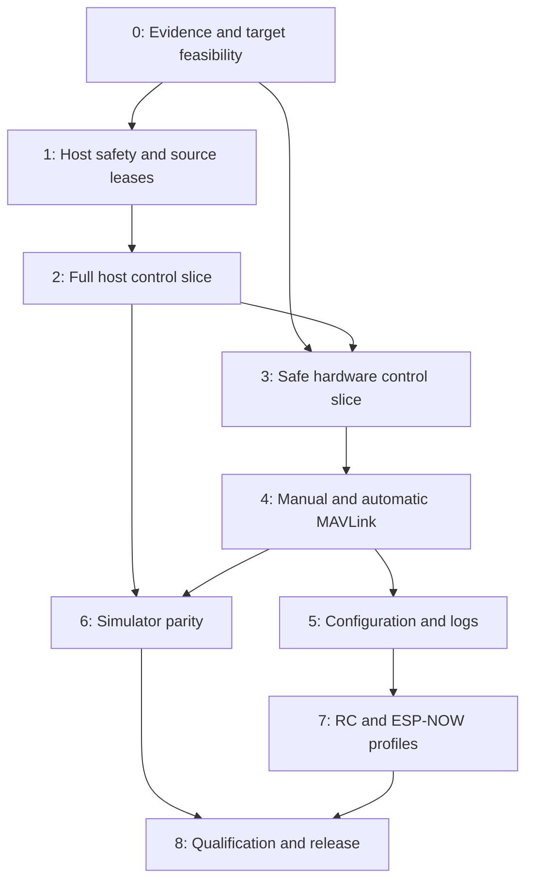

# Flix Rust Rewrite Implementation Plan

Date: 2026-10-05. Status: implementation in progress; host and target build evidence recorded in [implementation status](rust-rewrite/implementation-status.md). Hardware qualification remains open.

Requirements: [Rust rewrite specification](rust-rewrite-spec.md). Evidence baseline: [architecture review](architecture-review.md), C++ revision `1f5b268`.

## 1. Delivery rules

Implement one runnable behavior at a time: reproduce the current contract, write its acceptance tests, implement it, integrate it, and measure it. The known C++ defects are regression inputs; they are not behavior to preserve.

Apply the engineering habits associated with Jon Gjengset's teaching at each step: explain the underlying mechanism, trace ownership and lifetimes, design narrow interfaces around real boundaries, and distinguish measured facts from assumptions. Use the type system where it enforces a meaningful invariant; verify temporal and hardware properties through tests and physical measurements.

Each phase closes with evidence and a recorded gate result: pass, fail, or awaiting a named external prerequisite. A package skeleton, successful compile, or simulator run cannot substitute for a required hardware measurement. Continue independent host work when hardware is unavailable, and leave the target gate explicitly open.

Repository setup and the software development slices are implemented. Checked tasks below have software evidence; unchecked tasks include unfinished integration or physical qualification. Once a phase is authorized, work through its locally implementable tasks without repeated permission requests. Physical motor operation and flight require the actual operator, equipment, and profile-specific qualification process.

Create packages only with real executable slices. Use the separate legacy C++ repository and its build entry points as the migration reference, maintain compatibility fixtures, and record intentional differences in a ledger. Do not combine a language migration with a new estimator or control tuning without separate measured justification.

## 2. Dependencies and critical path



Critical unknowns are output behavior during a stalled owner, IMU acquisition latency under radio load, the exact hardware profile, and authorized command interoperability. Prototype them early with stopped outputs. Simulator and host work can overlap hardware qualification in the dependency sense; this plan does not require delegation or multiple agents.

The first wireless Wi-Fi profile can qualify before optional ESP-NOW or additional boards. Label each profile separately; completion of one profile does not close another profile's gate.

## 3. Phase 0 — Evidence baseline and hardware feasibility

Deliverable: a reproducible baseline, compatibility inventory, and small target feasibility executable with stopped outputs.

* [x] P0-01: Preserve the reviewed disarm, stale-command, and clock-discontinuity probes as deterministic host fixtures. Inventory nominal controller cases and intended changes.
* [ ] P0-02: Record the locally obtainable board/module, IMU markings, bus, power, pins, motor drivers, and available measurement tools. Separate bench and flight profiles.
* [x] P0-03: Compare ESP-IDF Rust and `esp-hal` candidates against required sensor, PWM, USB, Wi-Fi, ESP-NOW, persistence, and stop behavior. Record an ADR with selected versions and reversal criteria.
* [ ] P0-04: Build/flash a stopped-output image that identifies the IMU, timestamps samples, and emits bounded diagnostics. Audit the original FlixPeriph configuration against the manufacturer datasheet.
* [ ] P0-05: Measure IMU rate/read latency, interrupt behavior, clock behavior, memory use, and output pin state through boot, reset, acquisition stall, and radio activity. Keep motor power isolated for the initial measurement.
* [x] P0-06: Freeze the nominal protocol dialect, baseline parameter schema, source order, controller tolerance plan, and provisional timing workload. Define exact command loss and output-stop deadlines for bench tests.

Typical focused work items are 4–8 engineering hours each; driver and hardware uncertainty may require another bounded spike. Record what it answered before extending it.

Gate: one toolchain builds the selected target; the board and sensor are identified; a bounded acquisition strategy and demonstrable stopped-output/reset strategy exist; timing/memory budgets are accepted or revised from measurements. Hardware-dependent items remain open until measured. Independent Phase 1 work may start from the host evidence before this gate closes.

## 4. Phase 1 — Executable safety and source model on the host

Deliverable: feed timestamps and commands into a host runner and observe validated output with deterministic safety transitions.

* [x] P1-01: Create `flight-core` and the replay runner with explicit host/default members and a `no_std` build check for the core.
* [x] P1-02: Implement validated scalar, vector/frame, quaternion, integer tick, and duration contracts needed by the first slice.
* [x] P1-03: Implement Boot/Standby/Armed/Failsafe/Fault transitions, explicit arming, fault latching, and current authorization generation.
* [x] P1-04: Implement source selection and leases for pilot and automatic inputs, including unset source, late input, takeover, and heartbeat-without-setpoint cases.
* [x] P1-05: Implement the final motor gate and expiring output frame. Test diagnostic intents, invalid numerical state, disarm, and stale cached frames.
* [x] P1-06: Build a scenario runner that reports state, chosen source, applied motors, and reason codes; property-test bounded outputs and every stop transition.

Gate: the F01 and F02 scenarios produce stopped outputs when the specified policy requires them; every mode/intention reaches the same gate; no command source or timing boundary bypasses it. Tests must fail if the disarm check or generation invalidation is removed. Core ticks allocate no heap memory.

## 5. Phase 2 — Complete deterministic control slice

Deliverable: timestamped sensor and pilot input produces STAB/ACRO/AUTO attitude/rate outputs through the same safety gate on the host.

* [x] P2-01: Port vector/quaternion operations and frame conversions, including degenerate inputs and rotation-sign tests.
* [x] P2-02: Port calibration application, gyro filtering/integration, ground correction, and the explicitly documented level assumption. Expose estimator health and sample age.
* [x] P2-03: Port attitude and rate controllers with explicit state-reset rules and bounded integrators. Compare approved nominal cases before changing tuning.
* [x] P2-04: Port mixing/desaturation and final clipping. Test motor ordering, torque signs, low thrust, and output span exceeding one.
* [x] P2-05: Compare C++ and Rust replay outputs within predeclared numerical tolerances; record differences in a behavior ledger and inspect each difference.
* [x] P2-06: Benchmark core execution, core-state size, and host allocation behavior; run properties for transitions, numeric bounds, and sample/clock discontinuities.

Gate: one replay slice covers each supported flight intent; nominal differences satisfy accepted tolerances; all safety cases remain enforced; output matches the simulator/hardware contract. Host benchmark results are labeled host results and do not establish target deadlines.

## 6. Phase 3 — Safe control slice on the selected ESP32

Deliverable: real IMU acquisition drives the Rust core and PWM on an instrumented bench, with defined stop behavior under faults.

* [ ] P3-01: Add the chosen ESP32 application with pinned SDK/toolchain and a validated board profile. Initialize stopped outputs first.
* [x] P3-02: Implement bounded IMU acquisition, configuration readback, freshness tracking, calibration state, and error mapping.
* [ ] P3-03: Implement the motor adapter, current-generation/deadline checking, and stop/expiry mechanism. Validate PWM resolution, frequency, stop level, and exact pin mapping.
* [ ] P3-04: Implement the single-owner tick schedule and counters for acquisition age, latency, jitter, overruns, and target resource use.
* [ ] P3-05: Inject disconnect, stale samples, invalid state, loop stall, panic/reset, and simulated command loss. Measure actual output traces, including diagnostic output paths.
* [ ] P3-06: Conduct a 30-minute timing run under the declared target workload. Record min/max/percentiles, all missed deadlines, stack/heap high-water marks, and resource limits.

Gate: accepted timing budgets hold for the declared workload, every specified stopped-output response is measured within its bound, and acquisition cannot indefinitely preserve PWM. A watchdog reset without an output trace fails the stop-evidence gate. Confirm the actual flight output board and power circuit before interpreting bench results as airframe results.

## 7. Phase 4 — Authorized MAVLink flight interfaces

Deliverable: pyflix/QGroundControl can observe the Rust system, explicitly arm under valid preconditions, issue manual/AUTO attitude/rate inputs, and disarm through bounded communication paths.

* [x] P4-01: Add `flight-protocol` with bounded decode and encode, pinned dialect/features, complete field initialization, and exact unit/frame tests.
* [x] P4-02: Implement typed message validation for counts, indices, masks, quaternion norms, scalar limits, destination, and source policy. Fuzz malformed, truncated, and concatenated frames.
* [x] P4-03: Implement bounded ingress, latest-source mailboxes, command queue rejection, and a reserved authorized-stop indication. Verify safe behavior under maximum ingress and overflow.
* [ ] P4-04: Implement Wi-Fi UDP and telemetry snapshots without blocking the flight owner. Validate the selected authorization/provisioning design and endpoint learning behavior.
* [ ] P4-05: Test initial connection, explicit arm/disarm, mode transitions, source loss, takeover, reconnect, and AUTO command leases with pyflix/QGroundControl. Document all intentional denials and prerequisites.
* [x] P4-06: Correct Python send-before-wait races and connection cleanup that affect release validation. Test immediate replies, slow callbacks, close, and concurrent requests with mocked transports.

Gate: a complete authorized command reaches the core, malformed/unauthorized traffic cannot change state or renew leases, and disarm is not displaced by queue saturation. Under traffic/telemetry stress, measured output deadlines remain satisfied or the declared overload response occurs. Client ACK timing and semantic compatibility are recorded.

Bench USB development can use a clearly declared policy before wireless authorization passes. Wireless flight requires the actual client provisioning and authorization gate; available Rust signing support does not establish end-to-end compatibility.

## 8. Phase 5 — Configuration, diagnostics, and logs

Deliverable: validated configuration survives a reboot, disarmed maintenance completes without reentrancy, and a bounded log snapshot can be downloaded and analyzed.

* [x] P5-01: Inventory all 96 baseline parameters; generate validation, defaults, metadata, and compatibility names from one schema. Mark obsolete metadata entries explicitly.
* [x] P5-02: Validate startup settings, cross-field constraints, supported pins, calibration spans, integer conversion, and board capability. Implement clear diagnostics for invalid storage.
* [x] P5-03: Add versioned persistent settings, interruption tests, export/import validation, and a manual rollback procedure. Perform flash writes only in stopped exclusive maintenance.
* [x] P5-04: Implement the allowed console commands and an exclusive maintenance state. Reject armed calibration, motor tests, reconfiguration, reset, and large transfers as specified.
* [x] P5-05: Implement a bounded versioned flight log and disarmed snapshot transfer with offsets/counts. Update downloader completeness handling and converter limits.
* [ ] P5-06: Split offline metadata consistency from hosted publication checks; add build IDs, fault reasons, overflow/timing counters, and artifact metadata.

Gate: reboot and interrupted persistence retain a valid recoverable configuration; invalid storage never produces ordinary motor authority; maintenance cannot suspend armed control; logs have defined size and transfer completeness; metadata reflects the implemented parameter set.

## 9. Phase 6 — Simulator parity and fault replay

Deliverable: the existing Gazebo environment runs the Rust core through a small tested ABI and exercises the same output and source rules as the target.

* [x] P6-01: Implement a versioned C ABI with explicit scalar widths, lengths, handles, error results, reset, and lifetime ownership. Review each unsafe block and prevent unwind across the ABI.
* [ ] P6-02: Replace only the firmware-control portion of the plugin; preserve an explicit C++ comparison mode during migration. Apply authorized bounded motor values to forces.
* [x] P6-03: Align tick order, clocks, reset generations, input deadlines, and logging snapshots between target and simulator.
* [x] P6-04: Make heading truth correction an explicit teaching option; use the uncorrected estimator for ordinary acceptance scenarios.
* [x] P6-05: Add packet/source loss, invalid/stale IMU, timing gaps, saturation, mode changes, and direct-diagnostic-stop scenarios. Record seed, profile, fixtures, and outcomes.
* [x] P6-06: Test separate instance state and ABI misuse cases. Document unavailable hardware behavior and the simulation model's limits.

Finite P6-05 coverage: [seventeen-scenario adverse integration](rust-rewrite/phase6-adverse-integration.md). Physics seed limitations and landing/contact failure remain explicit; this does not close the full Phase 6 gate.

Gate: replay and simulation agree on safety and final motor outputs for equivalent inputs; reset cannot reuse prior command/output authority; instances do not share state; the declared controller scenarios pass without hidden heading correction. Simulator evidence remains distinct from physical evidence.

## 10. Phase 7 — RC and optional ESP-NOW profiles

Deliverable: each selected additional transport provides bounded, validated control into the same source-selection and safety model.

* [x] P7-01: Implement and validate SBUS decoding/calibration, channel limits, driver failsafe/lost-frame semantics, source freshness, and intentional RC takeover.
* [ ] P7-02: Measure RC and wireless coexistence, authority selection, command-loss behavior, and radio load against the flight tick budget.
* [ ] P7-03: Spike ESP-NOW API, encryption/key provisioning, frame sizing, and callback context for the pinned SDK before implementing it.
* [ ] P7-04: Implement bounded peer discovery and lifecycle with a single owner. Validate peer/key storage and callback handoffs; document peer limits and failure behavior.
* [ ] P7-05: Validate the USB proxy and pyflix transport integration, including disconnect, malformed discovery, full peer capacity, and immediate stop under load.
* [ ] P7-06: Qualify each board/transport variant independently; update the support matrix with measured versions and test results.

Software progress: [runnable proxy and signed serial integration](rust-rewrite/proxy-integration.md). Physical transport gates remain open.

Gate: each claimed profile passes authority, freshness, overload, output-stop, and timing checks. If optional ESP-NOW remains unavailable, the Wi-Fi release may proceed with ESP-NOW marked unqualified; do not claim parity for that transport.

## 11. Phase 8 — Hardware qualification and first release

Deliverable: one clearly named airframe/board/sensor/transport configuration with reproducible firmware, measured behavior, recovery documentation, and a recorded flight envelope.

* [ ] P8-01: Close exact airframe mass/frame fit, electrical power, motor direction, propeller, output board, battery measurement, and low-voltage policy decisions.
* [ ] P8-02: Freeze flight timeout/failsafe profiles and measured timing/stop thresholds. Review the outcome of source-loss and state-loss responses for the actual airframe.
* [ ] P8-03: Complete instrumented tests with propellers removed: arming denials, every disarm path, stall/reset, sensor failure, radio loss, overload, reconfiguration denial, and battery/power behavior.
* [ ] P8-04: Perform operator-controlled restrained and then limited flight evaluation only after the relevant preceding gates pass. Record tuning changes, durations, load, environment, state transitions, and stop/loss behavior.
* [ ] P8-05: Build reproducible release artifacts, verify flashing/recovery and parameter rollback on the supported hardware, and record exact hashes and dependencies.
* [ ] P8-06: Review all SAF requirements, compatibility changes, outstanding findings, supported profiles, and evidence. Update usage, architecture guidance, troubleshooting, and CI documentation.

Gate: the spec's mandatory requirements are evidenced, the declared workload meets accepted budgets, the operator has measured the actual hardware, and the release names its tested flight envelope. Missing hardware evidence leaves this gate open. Claims such as production-grade, flight-qualified, or support for another board require the corresponding evidence and must not follow from a successful build alone.

## 12. Verification commands and evidence

The packages exist and these focused checks run locally. `sh scripts/check.sh` is the consolidated host gate; `make sim-check` exercises the actual Gazebo plugin:

```bash
cargo fmt --all --check
cargo clippy -p flight-core -p flight-protocol --all-targets -- -D warnings
cargo test -p flight-core -p flight-protocol
cargo build -p flight-core --no-default-features --release
```

Add explicit host replay, ABI, fuzz, and exact target-build commands as each package lands. Do not use a generic `--all-features` build to combine incompatible host/embedded transports or multiple chip selections. Check dependency policy and lockfile advisories; record accepted exceptions with their target impact.

For each gate, keep a dated record under `docs/rust-rewrite/evidence/` containing revision, requirement IDs, board and sensor profile, toolchain/SDK, exact command or hardware procedure, fixtures/load, raw trace/log references, pass/fail thresholds, results, and unresolved items. Create this directory when the first real evidence is captured.

Host properties, packet fuzzing, and simulator tests run in CI where dependencies permit. Hardware tests are explicitly marked and run on the actual named device. Safety properties cover transitions and temporal behavior; a coverage percentage does not replace those checks.

## 13. Provisional schedule and estimation

This calendar is a planning envelope for one experienced engineer with working hardware and instruments. It is not a delivery commitment. Re-estimate after Phase 0; apply roughly 30% contingency to measured task estimates, and track time awaiting hardware separately.

| Illustrative window | Outcome |
| --- | --- |
| Week 1 | Baseline reproduction, sourcing/profile record, feasibility spikes, initial host safety slice |
| Weeks 2–3 | Host safety, estimator, controller, mixing, and replay contracts |
| Weeks 4–5 | Instrumented ESP32 slice and bounded manual/AUTO protocol |
| Weeks 6–7 | Configuration, logging, client fixes, and simulator integration |
| Week 8 | RC and selected transport qualification; optional ESP-NOW may extend this window |
| Weeks 9–12 | Airframe qualification, tuning, repeated fault evidence, recovery, release review |

Break coding tasks into 4–8-hour reviewable changes with their own acceptance case. Hardware integration, radio timing, and controlled flight are uncertainty-heavy; do not compress their gates to satisfy a calendar. Full feature parity across every original board/IMU would be a separate estimate.

## 14. Risk register

| Risk | Impact / likelihood | Mitigation | Fallback |
| --- | --- | --- | --- |
| Supplier board or sensor differs from listing | High / medium | Marking, identity, schematic, and acquisition tests | Alternate supplier/profile; preserve host progress |
| Radio or driver latency misses budget | High / medium | Early target traces, bounded acquisition, explicit workload | Revise adapter/runtime through ADR; qualify a narrower profile |
| PWM remains active during owner stall/reset | High / unmeasured | Independent stop/expiry and physical trace | Gate/driver hardware change; no flight qualification |
| S3 bench board unsuitable for small frame | High / medium | Separate bench and airframe profiles | Compact board after profile validation |
| Rust driver/dialect differs from C++ | High / medium | Readback and protocol fixtures, pinned dependencies | Minimal audited adapter; explicit unsupported feature |
| Simulator hides drift or saturation | Medium / confirmed baseline concern | Same gate and output clamp; uncorrected estimator mode | Replay and hardware evidence remain authoritative |
| Signing incompatible with current clients | High / unmeasured | Early real-client provisioning tests | Recorded alternative authenticated transport policy |
| Parameter/log migration loses information | Medium / medium | Versioned exports, interruption/roundtrip tests | Keep original export; manual recovery |
| New control tuning obscures language parity | High / medium | Freeze nominal model first; separate change ledger | Return to measured baseline gains |
| Multi-board scope expands before first target passes | High / medium | One named profile per qualification | Defer additional boards and sensors |

## 15. Completion and next implementation step

Follow the [remaining execution plan](rust-rewrite/remaining-plan.md) for R0–R7 slices, acceptance contracts and dependencies from the current implementation. Its scope decisions remain proposed until recorded as accepted.

The current development delivery and remaining gates are recorded in [completion report](rust-rewrite/completion-report.md). The next hardware step is to identify and wire the exact board/sensor with motor power isolated, then measure acquisition and stopped-output behavior. Optional ESP-NOW proxy integration, QGroundControl provisioning, full plant comparison and hardware/flight qualification remain open; completed host and simulator checks do not close those gates.

Completion of the plan means a qualified named Rust profile and supported external interfaces, with review findings closed or explicitly scoped to deferred profiles. It does not mean every legacy line has been translated or every original hardware combination is supported.
