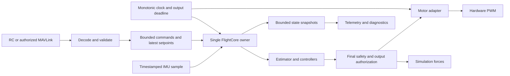

# Flix Rust Rewrite Specification

Date: 2026-10-05. Status: implemented development design, revision 0.2. Physical qualification and selected integrations remain open; see [implementation status](rust-rewrite/implementation-status.md).

Baseline: C++ revision `1f5b268` and the [embedded architecture review](architecture-review.md). Delivery work and acceptance gates are defined in the [implementation plan](rust-rewrite-plan.md).

## 1. Objective and interpretation

Rewrite Flix's flight application in Rust while preserving its educational scope and useful MAVLink interfaces. Establish explicit ownership, bounded execution, valid numerical inputs, command authority, and a final motor safety boundary. Build evidence on the host, in simulation, and on actual hardware before claiming flight support.

The engineering approach draws on Jon Gjengset's teaching: reason from first principles, understand the machinery beneath abstractions, make ownership and costs visible, encode useful invariants in types, and use tests and measurements to settle uncertain behavior. Apply those habits through small executable slices with explicit failure contracts and verification gates. The design choices here are proposals for Flix, not statements of Jon's views or Helsing's internal architecture.

`MUST` identifies a required behavior. `SHOULD` identifies a preferred design whose deviation requires a documented reason. Proposed numerical budgets and hardware choices remain provisional until the relevant plan gate records measurements and accepts them.

Success means a supported hardware profile can run stabilized and rate-controlled flight, receive authorized fresh inputs, reliably disarm, diagnose faults, and use the same core in simulation. Rust compilation alone does not establish those properties.

## 2. Scope

### First release

* A portable Rust core for math, calibration application, estimation, input selection, flight state, controllers, mixing, and output authorization.
* One validated board, one IMU, and one brushed-motor output profile before additional hardware profiles.
* STAB and ACRO flight modes, then AUTO attitude and rate setpoints with explicit source leases.
* Manual RC and MAVLink input, bounded MAVLink telemetry, validated parameters, disarmed maintenance, and bounded logs.
* A C-compatible simulator adapter using the same Rust core and final output values.
* Compatibility tests for QGroundControl and pyflix, including clear errors for intentional behavior changes.
* Reproducible builds, hardware evidence, flashing/recovery instructions, and a recorded flight envelope.

The Python client and C++ Gazebo physics plugin remain useful integration components. The rewrite addresses their reviewed defects where they affect the Rust release, rather than requiring every repository language to change. Vendor hardware and radio libraries may still contain C and binary components.

Position/velocity control, autonomous navigation, a new estimator, new airframes, brushless motor support, additional IMUs, OTA, and a custom radio stack are separate capabilities. RAW torque and direct motor output are retained only as explicit diagnostic/test capabilities in the first release, as described below.

## 3. Hardware profile and Bangladesh sourcing

The expanded [Bangladesh BOM](rust-rewrite/bangladesh-hardware-bom.md) records
quantities, instruments, propulsion/power candidates and current stock caveats.
It supersedes the short sourcing snapshot below where a product-page stock
check differs: the TechShopBD MPU6050 page now says out of stock.

### Proposed first profile

Use an ESP32-S3 development board and an MPU-6050 breakout for initial bench development. This is a sourcing-led proposal, not an assertion that the assembled system is flight-qualified. The existing C++ source already has an MPU-6050 path, which gives us a comparison baseline. Classic ESP32 is the fallback if the selected S3 board or toolchain cannot pass the feasibility gate.

Supplier pages checked on 2026-10-05:

| Candidate | Listing evidence | Role |
| --- | --- | --- |
| ESP32-S3 DevKitC1, HTE | [Product page](https://www.htebd.com/esp32-s3-devkitc1-dual-usb-type-c-development-board/) showed in stock at ৳1,050 | Proposed bench board |
| ESP32-S3 DevKitC1 N16R8, TechShopBD | [Product page](https://techshopbd.com/product/esp32-s3-devkitc1-n16r8-development-board-dual-usb-type-c) listed ৳980.04 with an add-to-cart control | Alternative supplier; verify exact module |
| MPU-6050 breakout, HTE | [Product page](https://www.htebd.com/mpu-6050-accelerometer-gyroscope-module/) showed in stock at ৳250 | Proposed first IMU |
| GY-521 MPU-6050, TechShopBD | [Product page](https://techshopbd.com/product/6dof-accelerometer-gyroscope-gy-521-mpu-6050) listed ৳320.04 | Alternative supplier |
| Classic ESP32 DevKit V1, TechShopBD | [Product page](https://techshopbd.com/product/esp32-devkit-v1) listed ৳490.04 | Fallback profile |
| ICM-20948, HTE | [Product page](https://www.htebd.com/icm-20948-9-axis-motion-tracking-sensor/) showed in stock at ৳1,999 | Future sensor candidate; not needed for initial control parity |

Prices and listing status are a dated snapshot. These links establish sourcing candidates, not chip identity, sensor quality, or guaranteed availability at checkout. The HTE board-plus-IMU subtotal is ৳1,300 before shipping, wiring, instruments, or motor hardware.

A development board may not fit the original small drone frame or mass budget. Bench acceptance and airframe acceptance are separate. Before assigning flight pins, record the exact board/module marking, flash/PSRAM configuration, schematic, voltage regulation, reserved pins, boot-strapping pins, USB use, and motor-driver connections. A compact flight board can reuse the core after its own output and timing checks.

The IMU gate MUST verify identity, configuration readback, axes, sample rate, calibration, data-ready behavior, and I²C timing. Use the manufacturer's datasheet for technical configuration; retailer descriptions are sourcing evidence. A nominal 1 kHz configuration does not establish successful acquisition at 1 kHz under radio load.

## 4. Technology decisions

| Decision | Proposed choice | Reason | Revisit when |
| --- | --- | --- | --- |
| Portable control code | `no_std` Rust without an allocator | Host-testable deterministic state and small embedded footprint | A demonstrated core requirement cannot be expressed without allocation |
| Initial ESP32 runtime | ESP-IDF v5.4.2 through a direct C boundary; Rust Xtensa v1.88.0.0 | Keep driver lifetimes, expiry writes and handoffs explicit; see [ADR 001](rust-rewrite/adr-001-runtime.md) | Timing, memory, maintenance, or driver evidence fails the feasibility gate |
| Alternative runtime | `esp-hal` and its associated radio/runtime packages | Independent hardware-adapter candidate | ESP-IDF adapter fails, or measured benefits justify the change |
| Scheduler | One owner for the flight tick; bounded communication handoff | Explicit state mutation and execution budget | Measurements justify another execution model |
| Protocol | Bounded MAVLink 2 subset with pinned ID/CRC/length inventory | Preserve selected external interfaces and test packet boundaries | Exact compatibility or feature size fails the spike |
| Numerical model | `f32` for controller math; integer time; explicit units/frames | Match baseline where meaningful and avoid absolute float time | Measurements show inadequate precision |
| Simulator | Small C ABI around Rust, existing physics plugin | Compare core behavior without replacing the physics environment | Host/plugin compatibility fails |

ESP-IDF Rust wrappers provide driver and service integration, while the project describes those wrappers as a community effort. The selected runtime uses the direct SDK boundary recorded in ADR 001; broad Rust wrappers were evaluated as a candidate. Dependency versions and SDK combinations MUST remain pinned. This is a proposed selection rather than a claim of measured suitability. [Rust on ESP-IDF](https://github.com/esp-rs/esp-idf).

The alternative ecosystem includes `esp-hal`, storage, runtime, and radio crates. Radio support can require allocation and a scheduler; consequently `no_std` is not a promise that the entire firmware has no allocator. The core must remain independent of these choices. [Espressif ecosystem overview](https://docs.espressif.com/projects/rust/book/introduction/ancillary-crates.html), [esp-radio documentation](https://docs.espressif.com/projects/rust/esp-radio/1.0.0-beta.0/esp32c3/esp_radio/index.html).

The Rust MAVLink crate offers configurable dialects, embedded support, and signing features. Verify the chosen version's compatible features, extension fields, Flix autopilot identifier, packet sizes, and actual QGroundControl/pyflix behavior before acceptance. [MAVLink crate documentation](https://docs.rs/crate/mavlink/latest).

## 5. Component boundaries and ownership

The workspace lives at the flix-rust repository root. Start small and add each package with its first executable slice:

```text
flix-rust/
  Cargo.toml                 # workspace; explicit host default members
  Cargo.lock
  rust-toolchain.toml
  crates/flight-core/        # no_std; state, math, estimation, control, safety
  crates/flight-protocol/    # bounded decoding, validation, wire mapping
  apps/replay/               # deterministic host runner and comparison
  apps/esp32/                # board runtime, drivers, radio, persistence
  adapters/gazebo/           # host library and C ABI definitions
  tests/fixtures/            # versioned inputs and expected outcomes
```

Do not create empty packages as proof of progress. Board-specific toolchain flags MUST NOT break ordinary host tests. If one toolchain cannot support both environments, declare separate host and target invocations rather than relying on whichever compiler is installed.



`FlightCore` owns mutable flight state. Communication code produces validated commands and immutable input snapshots; it cannot set `armed`, controller targets, or motor globals. The estimator owns estimator history, the controller owns PID state, the source selector owns current authority, and the supervisor owns flight lifecycle.

The motor adapter owns the hardware peripheral and accepts only output frames produced by the final gate. A separate bounded hardware stop mechanism may revoke output authority during a stalled owner; it must never introduce a second ordinary command writer. The mechanism and synchronization need an audited adapter contract.

Traits belong at real boundaries: IMU sample acquisition, clock, motor commit/stop, and persistent storage. Pure math and controllers should be concrete types. There is no generic event bus or service framework requirement.

## 6. Data contracts

### Units, frames, and numerical validity

* Internal body coordinates MUST remain FLU. MAVLink conversion MUST occur at the protocol boundary and be tested in both directions.
* Motor order MUST remain `[rear-left, rear-right, front-right, front-left]` unless a named board mapping explicitly translates it.
* Gyro values are radians/second, acceleration is meters/second², angles are radians, throttle is `[0, 1]`, and roll/pitch/yaw pilot axes are `[-1, 1]`.
* Public constructors MUST reject NaN, infinity, out-of-range scalars, and degenerate quaternion norms. Normalization may correct a finite nonzero quaternion; excessive or invalid input is rejected.
* Intentional controller selection MUST use an enum. NaN MUST NOT select an attitude, rate, torque, or direct-output path.
* Time MUST use integer monotonic ticks with explicit duration arithmetic. Hardware counter rollover is handled by the adapter; unexpected clock rollback produces a diagnostic fault and invalidates output authority.

Select and pin a portable math implementation for `no_std` trigonometry and square roots during the nominal comparison spike. Compiler optimization and floating-point behavior belong in the reproducibility record; host and target equivalence use predeclared tolerances rather than assuming bit-identical library results.

Illustrative contracts, not implementation promises:

```rust
pub enum ControlIntent {
    Stabilized { pilot: PilotInput },
    Acro { pilot: PilotInput },
    Attitude { target: UnitAttitude, rates: BodyRates, thrust: Throttle },
    Rates { target: BodyRates, thrust: Throttle },
}

pub struct ImuSample {
    pub captured_at: Tick,
    pub sequence: u32,
    pub gyro: BodyRates,
    pub acceleration: BodyAcceleration,
}

// Members and constructors stay private to output policy.
pub struct AuthorizedMotorFrame {
    values: [Throttle; 4],
    generation: u32,
    expires_at: Tick,
}
```

Direct motor tests use a distinct maintenance command and expiring diagnostic authorization. An authorized frame is not a timeless permission: the runtime MUST verify current generation, deadline, and stop latch when committing it. It MUST discard cached frames after disarm, fault, reset, or mode/source changes.

The tick API SHOULD accept a timestamped input snapshot and return applied motor demand, a state snapshot, and bounded diagnostics. An invalid input or internal error MUST still select a defined stop/fault result; returning an error must not preserve the previous output implicitly.

## 7. Flight lifecycle and safety requirements

### Lifecycle

| State | Outputs allowed | Entry and exit rules |
| --- | --- | --- |
| Boot | Stop | Initialize output-stop behavior before sensors or radio |
| Standby | Stop | Valid configuration, sensor health, and self-check permit arming requests |
| Maintenance | Bounded diagnostic outputs only | Enter from Standby; exclusive operation; expiring permit; no flight arm |
| Armed | Validated flight outputs | Explicit arm action plus current source and all preconditions |
| Failsafe | Profile-defined bounded response | Flight loss policy; no silent restoration to Armed |
| Fault | Stop | Latched fault; recovery through explicit checks and fresh arming |

State and flight mode are distinct concepts, with legal mode/intention combinations validated on transition. A safe action invalidates prior authorization generations. A new connection, reset, or timeout recovery MUST NOT automatically arm.

### Required invariants

| ID | Requirement | Acceptance evidence |
| --- | --- | --- |
| SAF-01 | Standby, Boot, and Fault always produce stop; disarm dominates every mode and intent | State-transition/property tests and measured PWM |
| SAF-02 | All ordinary and diagnostic output passes through the final safety policy | Dependency/code review and attempted bypass tests |
| SAF-03 | No fresh command or sensor sample means no ordinary output authority | Boundary-time tests, packet loss, sensor disconnect |
| SAF-04 | Authorized disarm/stop has a reserved path independent of full queues | Flood test plus output trace |
| SAF-05 | Arming is explicit and checks low thrust, selected source, configuration, calibrated healthy sensors, and no latched fault | Negative tests for every precondition |
| SAF-06 | Reboot, panic, blocked acquisition, or stalled control reaches board-defined stopped output within a measured bound | Power/reset/stall injection on each board |
| SAF-07 | Maintenance and peripheral reconfiguration cannot overlap Armed or Failsafe | Command-state matrix tests |
| SAF-08 | Every applied output is finite, bounded, correctly ordered, and belongs to the current generation | Properties, driver tests, and simulator parity |

Rust types reduce invalid state, but do not make these temporal or hardware properties true automatically. `Drop` is not a stop guarantee during abort, reset, or power loss. Watchdog reset is not itself evidence that PWM stops quickly enough. The actual stop path, GPIO defaults, driver gate behavior, and independent output expiry MUST be measured before a board is flight-qualified. [ESP-IDF watchdog behavior](https://github.com/espressif/esp-idf/blob/master/docs/en/api-reference/system/wdts.rst).

### Failure policy

The bench profile MUST stop on source loss, stale/invalid IMU, invalid estimate, unexpected clock change, output failure, or control stall. Controlled in-flight loss behavior requires a separately accepted flight profile.

A proposed flight profile may level and ramp down thrust on command loss only while the estimate remains healthy and the output path is functioning. The ramp is not altitude control and MUST NOT be described as a guaranteed landing. Sensor invalidity and explicit disarm require a stopped-output response. Record the associated airframe consequences rather than claiming one response is universally safe.

Flight lease durations, allowable IMU age, fault persistence, low-voltage behavior, and stop latency are open profile decisions. They must be explicit and tested before flight; a bench default cannot silently become a flight setting.

## 8. Control-source contract

RC, wireless manual control, and automatic control are separate source identities. Each accepted input records locally measured arrival/capture time and a freshness deadline. Sender timestamps alone MUST NOT extend authority. Repeated telemetry or heartbeat messages MUST NOT renew the control lease.

Source selection is explicit. The provisional policy is configured RC priority when enabled, wireless manual control only when selected, and AUTO only after a deliberate transition. Pilot takeover from AUTO requires a fresh validated pilot input and configured transition rule. Exactly one source supplies an ordinary control intent per tick.

The selector MUST reject stale queued inputs, unauthorized senders, and incompatible setpoint masks before state mutation. Timeout ends the lease; late traffic cannot revive a latched stop without a new valid transition. A malformed packet must not renew a source lease.

## 9. Execution and memory contracts

The flight owner MUST perform bounded work. It must not wait for networking, formatting, allocation, persistence, or console completion. IMU acquisition requires a deadline; either a bounded driver call or a separately timestamped latest-sample path must supply it. ISR/callback code copies bounded data or records flags, with no unbounded allocation or command execution.

Initial engineering targets to evaluate during the hardware spike:

| Measure | Proposed target | Meaning |
| --- | --- | --- |
| Control cadence | 1 kHz | 1,000 µs period; validate delivered IMU rate |
| Sample-to-output latency | At most 1,000 µs | Capture timestamp to final output commit under declared workload |
| Core computation | At most 500 µs | Estimation, control, mixing, and final gate |
| Scheduling jitter | At most 100 µs | Deviation from accepted tick schedule |
| Hot-path allocation | Zero | After startup for flight tick and its handoffs |
| Core dynamic state | At most 8 KiB | Excludes target stack and configurable log storage; verify size |
| Evidence workload | At least 30 minutes | Radio load, maximum accepted telemetry, input traffic, and logs |

These are proposed engineering targets, not measured claims or a verified worst-case execution-time proof. Phase 0 must refine them using the actual board, sensor, and timing capture method. An accepted workload must have observed deadline misses counted explicitly. Overload testing must demonstrate the specified fault response; any flight-envelope budget change requires a recorded decision and revalidation.

Initial bounded-handoff design:

| Resource | Proposed bound | Overflow behavior |
| --- | --- | --- |
| Setpoint mailbox | One latest snapshot per configured source | Replace old sample; retain original arrival time |
| Decoded command queue | 8 entries, at most 2 serviced per tick | Reject excess requests; count rejection |
| Authorized stop indication | Dedicated latched flag | Coalesce repeated stops; cannot be displaced by other commands |
| Receive buffers | 4 protocol-sized slots | Drop/reject overflow before decoding; never wait on flight owner |
| Console command | 70 wire bytes, matching reviewed shell interface | Reject excess and missing/invalid framing |
| State telemetry | One latest snapshot | Replace old snapshot |
| Transition/fault diagnostics | 32 entries | Count overflow; preserve current fault in state snapshot |
| Flight log | Up to 1,000 records with a versioned schema | Overwrite oldest; count records; transfer a disarmed snapshot |

The packet buffer size MUST be derived from the pinned MAVLink serializer's maximum including extensions and signatures. Measure decoder and queue footprint. Bounded allocation in platform radio services is permitted only under a recorded platform memory budget; growth or allocation failure must degrade communication without corrupting flight state.

Phase 0 MUST declare input/telemetry rates, packet sizes, peers, disconnect/reconnect activity, logging rate, and the overload traffic used for timing acceptance. Test both normal maximum accepted traffic and sustained rejected traffic. A frequency target without that workload description cannot close the timing gate.

## 10. Estimator and controller policy

Preserve the baseline gyro integration, ground correction, controller cascade, and axis conventions initially, with documented numerical tolerances. Record expected differences for invalid data, saturation, timing, and transitions. Existing unsafe output behavior is not a parity requirement.

The estimator MUST expose sample age, valid orientation, and calibration state. Its landed/stationary heuristic MUST not be treated as a general guarantee of stationarity. Document the in-flight level assumption and heading-drift limitation. The first rewrite adds health boundaries without claiming improved estimation accuracy.

Controllers MUST reset or intentionally carry state on arming, mode/source changes, time discontinuities, and failsafe entry. Anti-windup must bound stored state and define how actuator saturation feeds back. Accept the exact method through comparison tests before retuning gains.

Mixer output MUST be constrained identically in hardware and simulation. Record desaturation policy and test outputs whose span exceeds one, low-thrust behavior, and torque priority. Controller validity checks must never skip disarming.

## 11. Protocol, authorization, and compatibility

Decoder output is an untrusted request. Validate destination, sender policy, field sizes, supported masks, finite values, ranges, source lease, and lifecycle permission before producing a command. Unknown messages cannot change state. Initialize every serialized field and use explicit microsecond/millisecond conversions.

Use an explicitly configured trusted control transport. The flight profile requires a validated authorization mechanism. MAVLink signing is a candidate; integration must verify key provisioning, replay rules, link identity, restart behavior, and actual client support. Physical USB bench access can use an explicitly marked development policy. System IDs, CRCs, and source addresses alone do not establish authentication. [MAVLink signing specification](https://mavlink.io/en/guide/message_signing.html).

Remote shell access is a typed allowlist of supported commands, not arbitrary execution. Arming, calibration, reconfiguration, log extraction, reboot, and motor tests obey the same lifecycle rules across USB and radio. Learn a telemetry endpoint only after accepted endpoint policy; telemetry discovery must not implicitly grant control authority.

| Interface | First-release behavior |
| --- | --- |
| Heartbeat, attitude, IMU, battery, RC, motors | Preserve IDs, units, conversions, and documented rates; initialize unused fields |
| Arm/disarm | Explicit request with consistent preconditions; disarm always reaches final gate |
| Mode changes | Supported combinations only; clear ACK/error; defined PID/lease transition |
| AUTO attitude/rates | Explicit arming and source lease; supported masks documented |
| Direct motor targets / RAW | Diagnostic profile only; reject flight usage with clear feedback |
| Parameter read/write | Preserve supported names and values within validated ranges |
| Shell | Preserve useful command names; reject unsafe lifecycle combinations |
| Logs | Versioned disarmed snapshot; bounded transfer and completeness reporting |
| Position/velocity | Remain unsupported and explicitly reported |

The intentional changes to automatic arming, diagnostic control, and command restrictions MUST be documented and tested with pyflix. Older clients must receive a clear unsupported/denied result or a documented prerequisite; successful delivery must never conceal rejected semantics.

## 12. Configuration, persistence, and deployment

Generate validation, defaults, and published metadata from one parameter schema. Validate pin capability, RC indices and calibration spans, sensor scale, PWM range/frequency/resolution, filter settings, timeouts, and cross-field combinations. Integer parameters reject nonintegral and out-of-range values before conversion.

Load stored settings into an untrusted representation, migrate an explicit schema version, then validate before hardware setup. Invalid stored configuration enters stopped diagnostics; it must not silently arm with partially loaded values. Do not deserialize Rust memory layouts as the persistent format.

Commit configuration only while stopped in an exclusive maintenance operation. Use transactional storage behavior that is verified against interruption. During the first Rust installation, export legacy parameter values and credentials; import only through validation. Preserve a known-good export and firmware artifact for manual rollback. Rollback support does not qualify the reviewed C++ firmware as safe for flight.

Firmware artifacts MUST record source revision, toolchain, SDK, board profile, parameter schema, protocol dialect, and hash. Flashing/recovery instructions must name the exact board and stopped state. Native Rust application code, C SDK code, bindings, and unsafe blocks are documented as separate audit boundaries.

## 13. Simulation and verification

The Gazebo adapter uses a versioned C ABI with fixed-width scalars and arrays, explicit units, length checks, and an opaque instance handle. Rust-specific layout, borrowed pointers across ticks, and unwinding MUST NOT cross the ABI. Host allocation for constructing an instance is permitted. Every drone instance owns its own core, clock history, and reset generation.

Simulation MUST apply the same final normalized motor values as hardware. Default estimator testing does not overwrite heading with ground truth; any teaching mode that does so is explicit. Replay and simulation share command ordering, resets, leases, and clock rules.

Required evidence includes deterministic host fixtures, property tests for transitions and numerical/output bounds, packet fuzzing, C++ comparison for approved nominal behavior, ABI checks, pyflix/QGroundControl integration, and target traces for sensor faults, output stop, radio overload, reboot, and loop stall. Properties over all reachable intents matter more than a single coverage percentage. Safety decision branches must have explicit case coverage and tests that fail if a stop check is removed.

Instrument loop maximum and percentile durations, jitter, sample age, missed deadlines, command/source state, overflow counters, stack/heap high-water marks, and actual applied output. Logs must avoid secrets and cannot block the flight owner.

## 14. Review finding traceability

| Review finding | Required rewrite response | Plan gate |
| --- | --- | --- |
| F01: disarm bypass | SAF-01/02/08 and one output gate | Phase 1, then measured in Phase 3 |
| F02: command freshness | Source identity, leases, explicit AUTO arming | Phases 1 and 4 |
| F03: parameters | Schema validation, safe reconfiguration, stop-first setup | Phases 3 and 5 |
| F04: blocking commands | Bounded handoffs and disarmed maintenance | Phases 4 and 5 |
| F05: IMU faults | Deadline, health, sample age, stopped fault path | Phases 0 and 3 |
| F06: field safety | Bounded decode, sizes/indices, parser fuzzing | Phase 4 |
| F07: masks/numerics/telemetry | Validated intents, frame conversion, complete serialization | Phases 2 and 4 |
| F08: control authority | Accepted sender policy and tested provisioning | Phases 4 and 7 |
| F09: time | Integer time, discontinuity tests, target capture | Phases 1 and 3 |
| F10: simulator/tests | Same output gate, explicit fidelity modes, fault injection | Phase 6 |
| F11: Python races | Request completion before send, client cleanup, bounded dispatch | Phase 4 |
| F12: log/tools bounds | Snapshot schema, bounded conversion, missing-record reporting | Phase 5 |
| F13: ESP-NOW lifecycle | Bounded peer state and single owner | Phase 7 |
| F14: reproducibility | Pinning, offline metadata, versioned artifacts | Phases 0, 5, and 8 |

## 15. Open decisions and acceptance

| Decision | Current position | Must close before |
| --- | --- | --- |
| Exact board/module and IMU | Locally listed S3 + MPU-6050 proposed; ownership unconfirmed | Target feasibility completion |
| Compact airframe board, motor drivers, power circuit | Unconfirmed; bench board is not a frame-fit decision | Physical output/airframe qualification |
| Runtime and driver versions | Development build selected in ADR 001; hardware timing unaccepted | Target runtime implementation |
| Flight loss policy and timing thresholds | Bench stops; flight policy open | Any propeller-equipped qualification |
| Sender authentication and client provisioning | Signing implemented; per-boot provisioning and actual client interoperability unproven | Wireless flight qualification |
| Battery monitor and low-voltage action | Require exact electrical profile | Flight qualification |
| Filter/controller tolerances and tuning | Baseline comparison first | Simulator acceptance and flight tuning |
| Other board/IMU and ESP-NOW profiles | Planned only after first target evidence | Claiming those profiles supported |

Host work can proceed while these decisions are open. The first flight profile cannot be declared supported until applicable hardware and policy gates close. Release acceptance requires every mandatory safety requirement, the compatibility matrix, reproducible artifacts, measured timing and stopped-output behavior, and recorded supervised flight evidence within a stated envelope.
