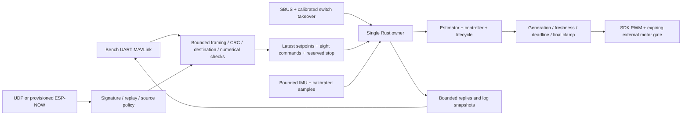

# Implemented architecture

`Flight` owns source leases, lifecycle, estimator and controller. Communication cannot write motors. Every output, including maintenance diagnostics, is an expiring `MotorFrame`. Commit checks the current generation, lifecycle, sample age and lease. Boot, disarm, faults, reset and source transitions invalidate earlier frames. Faults latch until an explicit stopped reset. Command loss stops immediately in the bench policy; it cannot implicitly rearm.

The owner accepts at most two queued commands per tick, one latest setpoint per source, one transfer chunk and bounded telemetry. A stop flushes all pending arms and setpoints. Heartbeats renew no lease. Source changes require disarming and a fresh low-thrust command. RC takeover uses a validated physical switch and disarms the old source; explicit authorized arming is still required.

Portable packages forbid unsafe code. Unsafe code is restricted to the SDK export module, simulator ABI and the allocation-counting test. The firmware static owner is initialized once, then accessed only by one SDK task. Callbacks use C queues or output-gate state and never borrow Rust state. The host ABI uses eight numeric handles, one mutex, per-instance ownership and no retained caller pointers. Pointer extent/lifetime/nonaliasing remain C caller obligations; arbitrary invalid pointers cannot be made safe by a null check.

The log stores 1000 records at 100 Hz: integer microseconds plus 14 floats, 64 bytes per record. Download header `FLXR`, version 1, record width 64 and record count are little endian. Offset/count transfers operate on a frozen stopped-maintenance ring. Attitude targets are zero when no attitude controller target exists; they must not be interpreted as desired level flight in ACRO/rates mode. Applied mean thrust replaces the legacy unsafe target-only thrust column.

Configuration has 96 compatibility names, generated metadata and explicit implemented/deferred/obsolete status. Immutable SDK pin/PWM fields are bound by the compiled board profile; unsupported transport, battery and alternate-board settings cannot be changed through parameter writes. Runtime settings require stopped exclusive maintenance. IMU changes schedule driver reconstruction and calibration before leaving maintenance; pending operations prevent arming. Hardware pin changes require rebuilding the profile. A CRC-protected, versioned two-slot record retains the last valid configuration through interrupted writes. Corrupt storage latches a configuration fault that cannot be cleared through an ordinary console fault-clear.

The Gazebo plugin preserves the plant and motor ordering, applies the same owner/gate, binds only loopback and removes hidden heading truth. Build the pinned legacy plugin separately for comparison. Gazebo 11 and ESP32 SDK compilation were not available in the initial host environment; their existence in the source tree does not establish successful integration.
