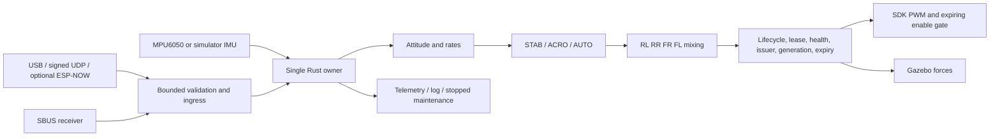

# Rust rewrite implementation report

> **Historical record.** For the current state see [status](status.md).

Latest five-item software work and retained failures: [software acceptance](software-acceptance.md).
Latest transport software: [USB / ESP-NOW proxy integration](proxy-integration.md).

Latest simulator extension: [Phase 6 adverse integration](phase6-adverse-integration.md).

Latest delivery: [reset/metrics integration](reset-metrics-integration.md), [remaining-phase execution report](execution-report.md) and
[development runbook](development-runbook.md). Host verification now includes
49 Rust and 34 Python tests. Wired enrollment, authenticated replies, the portable
battery guard, serial transport and timing histograms supersede the unfinished
software portions listed in the baseline table below. Physical and manual-client UI gates
remain open; signed QGroundControl discovery and parameter loading are verified. The baseline verification and sizes below are historical; current
SDK sizes and simulator outcomes are in the execution report.

Date: 2026-10-05. Repository: `flix-rust`. Source status: local, uncommitted development work; no remote repository or published release. Legacy reference: `1f5b268271536e45a9377d1c5317d3eb6f3c3bba`.

## Delivery scope

The software implementation spans the nine planned phases. This does **not** close all phase gates: physical measurements, client provisioning, optional transport integration and flight evaluation remain unfinished. The original C++ firmware is unchanged by this implementation.

| Phase | Implemented | Remaining gate |
| --- | --- | --- |
| 0: baseline/feasibility | Legacy defect probes, frozen protocol/schema, runtime ADR, actual Xtensa and SDK builds | Actual board/module, IMU identity/datasheet audit, electrical profile, flash and measurements |
| 1: safety | Explicit lifecycle, source leases, fault latching, integer clock, unique owner/generation/deadline output authority | Instrumented physical stop traces |
| 2: control | FLU math, estimator, calibrated samples, STAB/ACRO/AUTO, PID, desaturation; nominal C++ comparison | Sensor-filter and airframe tuning validation |
| 3: board | MPU6050 register driver/readback/calibration, SDK I²C/LEDC/UART, 1 kHz owner, expiring external gate, static log storage, watchdog | Wiring and power, acquisition/timing distributions, stack/heap measurements, 30-minute workload and stall/reset traces |
| 4: commands | Bounded MAVLink subset, signed wireless admission, stop mailbox, telemetry, UDP and corrected Python client | Trusted per-boot key/time provisioning and real QGroundControl/pyflix interoperability |
| 5: settings/logs | All 96 names inventoried, validated supported subset, CRC dual-slot records, interrupted-write recovery, maintenance, bounded logs and import/export | Actual NVS/power-interruption and migration/recovery checks; hosted metadata publication |
| 6: simulation | Versioned C ABI, independent instances/reset, real Gazebo 11 plugin build/load, persistent headless ground world and host UDP STAB/arm/motor/disarm check | Full physics parity, native world-reset/multiple-model physics and adverse-flight scenarios (ABI fault replay and browser whole-world recovery pass) |
| 7: RC/ESP-NOW | SBUS parsing/calibration/takeover; optional four-peer encrypted SDK adapter, bounded callback handoff | RC/radio coexistence measurements, provisioning persistence, USB ESP-NOW proxy and serial client integration; each profile qualification |
| 8: qualification | Build checks, development artifacts/manifests, recovery instructions, compatibility ledger and safety review | Battery/low-voltage policy, airframe decisions, props-removed traces, restrained/limited operator flight and qualified release |

ESP-NOW discovery was deliberately replaced with explicitly provisioned peers. This differs from P7-04 and requires a confirmed provisioning workflow. The narrow manual MAVLink codec and direct C SDK boundary are documented deviations in [ADR 001](adr-001-runtime.md). Deferred settings are rejected rather than accepted without an implementation.

## How the repository works

Four portable `no_std` packages contain the control, protocol, settings and owner/IMU integration. Host replay and Gazebo use `std`. The target firmware is a separate locked static-library workspace linked by ESP-IDF. C remains at SDK and Gazebo boundaries; this is not a repository containing exclusively Rust.

The estimator updates from timestamped, calibrated gyro/acceleration samples. Control intent selects a controller explicitly. The mixer produces bounded candidate motor values. A private output frame binds the values to the issuing owner, authority generation and expiry. The final commit checks current state, command/sensor freshness and numerical health. Disarm invalidates pending authority; heartbeats do not extend a setpoint lease. Diagnostics use the same gate in stopped exclusive maintenance with bounded power and duration.

Sensor transactions and ingress are bounded. Flash writes, calibration/reconfiguration and large log transfers require stopped maintenance. IMU changes reconstruct/calibrate the driver before maintenance can end. Invalid persisted data faults instead of silently loading defaults; only absent records permit first-boot defaults. Wi-Fi uses RAM configuration. Radio commands remain denied until trustworthy signing provision is supplied.

## Verification

The consolidated run passes **35 Rust tests and 19 Python tests**. All 400 nominal C++ comparison cases pass at tolerance `5e-6` (maximum absolute error `4.77e-7`). Both unwired/default and PWM/RC/Wi-Fi compile-only SDK profiles link. The enabled image uses 94% of the default 1 MiB app partition; partition/flash capacity must be reviewed before release.

Exact commands, results, hashes and raw logs are in [local evidence](evidence/local-verification.md). This includes host safety/failure tests, clean-room Python integration, nominal comparison using actual pinned C++ headers, an independent ABI check, an ARM `no_std` check, an actual ESP32-S3 Rust archive and full SDK image link, and a real Gazebo plugin smoke test.

The [compatibility ledger](compatibility.md) records intended changes; the [architecture](architecture.md) explains ownership/costs; [qualification](qualification.md) defines remaining physical checks. CI is configured but has not run remotely. Host timing is not target timing. Simulation and compilation do not verify reset, radio, motor or flight behavior.

## Safety requirement review

| Requirement | Software evidence | Unresolved physical evidence |
| --- | --- | --- |
| SAF-01: stopped states/disarm dominate | Lifecycle, invalid-intent and stop/queue tests | PWM and enable traces |
| SAF-02: one output policy | Private frame, issuer/expiry/diagnostic tests; SDK/ABI boundary review | Board wiring cannot bypass gate |
| SAF-03: fresh source/sensor | Lease boundaries, missing samples and clock regression | Sensor disconnect and packet loss on target |
| SAF-04: reserved stop | Full ingress stop preemption tests | Overload-to-output trace |
| SAF-05: explicit arming checks | Low thrust, calibration, source, configuration/fault and pending-maintenance tests | Actual calibration, operator/client interoperability |
| SAF-06: panic/stall/reset | Panic-stop handler, watchdog and SDK expiry implemented; target link passes | Measured maximum stop bound; remains open |
| SAF-07: exclusive maintenance | Armed diagnostic/flash/config denial; pending driver restart tests | Flash timing and driver reconstruction on board |
| SAF-08: bounded current output | Allocation/property tests, unique issuer/generation, 400-case nominal comparison, ABI checks | Physical motor order/polarity and airframe behavior |

## Gazebo session

A persistent headless Docker session is available as `flix-rust-gazebo`, with the Rust plugin exposed on host loopback UDP `127.0.0.1:14550`. The ground-start check passed parameter read, STAB mode, explicit low-thrust arm, positive motor telemetry, disarm ACK and subsequent four zero motor outputs. See [live session evidence](evidence/gazebo-live-session.md). This extends the earlier smoke test; it does not close simulator physics parity or physical qualification.

The browser viewer is available at `http://127.0.0.1:8765`. It renders actual Gazebo pose with passively observed Rust telemetry and provides session-authorized browser simulation controls. Browser input expires after 500 ms, with reserved disarm and explicit rearming. The alternate keyboard client uses the viewer’s `--view-only` mode. Browser interactions and a real keyboard arm/thrust/disarm sequence pass; [viewer evidence](evidence/browser-viewer.md) records the checks.

The latest integration and development artifact evidence is in the [completion report](completion-report.md).

New R0/R1 acceptance matrix, traced physics probes, paired C++ experiment and native-reset findings are recorded in [R1 evidence](evidence/simulator-r1.md). [Radio audit](radio-provisioning-audit.md) records the remaining provisioning path.

## Next concrete step

Identify the actual ESP32-S3 board/module and MPU6050, then record the power, motor driver and external enable circuit plus available measurement equipment. Keep motor power isolated and outputs disabled for first flashing and sensor measurements. Establish the battery/low-voltage and signing provisioning designs before qualifying radio-controlled operation. Follow the props-removed qualification procedure before any motor or flight evaluation.
