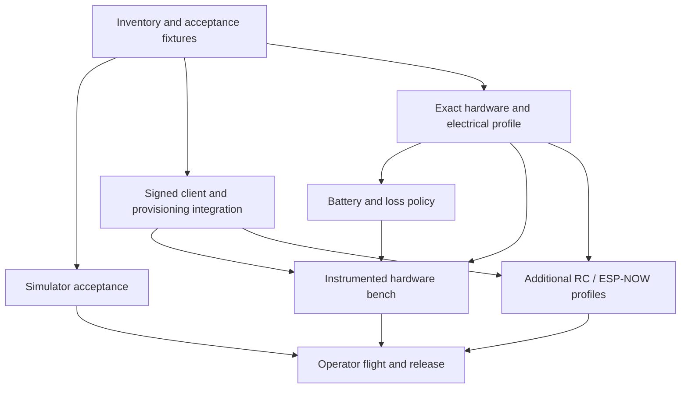

# Remaining Rust rewrite plan

> **Historical record.** For the current state see [status](status.md).

Latest five-item software work and retained failures: [software acceptance](software-acceptance.md).
Latest transport software: [USB / ESP-NOW proxy integration](proxy-integration.md).

Latest simulator extension: [Phase 6 adverse integration](phase6-adverse-integration.md).

Date: 2026-10-05. Status: proposed execution plan based on the current code and
recorded evidence. Applies to `flix-rust`; supplements the original phase plan.

Current delivery: [detailed execution plan](execution-plan.md),
[execution report](execution-report.md), [reset/metrics integration](reset-metrics-integration.md), and [development runbook](development-runbook.md).
The historical checkboxes below retain their full gates. Implementing a portable
part of a task does not complete its physical or actual-client acceptance.

The method draws on Jon Gjengset's teaching: understand the mechanism, state the
invariant, reproduce the failure, implement a small correction, then measure it.
These are this project's decisions and proposed gates, not Jon's personal advice.

## 1. What “done” means

**Milestone A — verified software integration:** the named simulator scenarios,
selected client/provisioning flow, metadata, exact target builds and recovery
interfaces have reproducible evidence. This does not establish physical flight.

**Milestone B — qualified first hardware profile:** one exact board, sensor,
airframe, power circuit and transport passes physical acquisition, output-stop,
timing, persistence, battery and operator flight gates. The release names its
measured envelope and includes recovery artifacts.

**Additional transport milestone:** RC/ESP-NOW/USB proxy profiles receive their
own integration and measurement gates. Proposed release order is wired bench,
then signed Wi-Fi, then optional ESP-NOW. Deferring ESP-NOW for a first release
requires a recorded scope decision; it does not complete all legacy transport
requirements. Do not silently mark original unchecked tasks complete.

Current host evidence: 42 Rust tests, 28 Python tests, 400 nominal C++ cases and 14
simulator ABI scenarios. Actual Gazebo arm/output/disarm and Firefox world
recovery pass. Sustained stable flight, native Gazebo reset and full plant parity
are not yet established. See [completion report](completion-report.md).

Execution update: [acceptance matrix](acceptance-matrix.md), [R1 evidence](evidence/simulator-r1.md) and [radio audit](radio-provisioning-audit.md). Checked items describe completed experiments, including failed parity findings; they do not close their overall gates.

Hardware sourcing: [full Bangladesh BOM](bangladesh-hardware-bom.md). The user
prefers locally available parts; exact delivered board, matched propulsion,
high-discharge battery, power circuit and pins remain prerequisites for R3.

## 2. Contracts to preserve

- One owner mutates flight state. Communication submits bounded validated inputs.
- Every output passes the final authority/health/freshness policy; disarm revokes
  queued and cached authority. Reset/reconnect never arm implicitly.
- Preserve FLU coordinates and RL/RR/FR/FL order across all boundaries.
- Core ticks remain allocation-free. File IO, provisioning, large transfers,
  calibration and persistence stay outside armed control.
- Errors distinguish invalid inputs, unavailable services and latched faults.
  Unknown battery data remains unknown; it cannot appear as healthy voltage.
- A type can prove a value is validated; it cannot prove GPIO stopped, a sensor
  was timely, or a radio peer was provisioned. Those need traces and procedures.
- Freeze nominal gains and plant parameters during migration comparisons.
  Proposed tuning changes need a separate recorded experiment and rollback.

For each slice: question → minimal failing case → observable contract → smallest
implementation → focused test → integrated measurement → gate record. Test each
slice before dependent work; finish with the consolidated suite.

## 3. Dependency order

The R7 → R6 edge applies when that transport is included in the release. Work
streams can progress independently; this plan does not require multiple agents.
Hardware availability does not prevent R0/R1 or the host portion of R2.

## 4. R0 — Freeze the remaining acceptance contract

Maps to P5-06/P8-06 and all remaining gate records.

- [ ] R0-01: Inventory implemented, partial, deferred and hardware-only tasks;
  link each to original P0–P8 IDs and SAF-01–08. Preserve historical evidence.
- [ ] R0-02: Define machine-readable scenario inputs, expected state/reason,
  source, motor bounds, sample age and event timestamps. Keep exact controller
  tolerance separate from physics trajectory tolerances.
- [ ] R0-03: Declare traffic workload: message sizes/rates, peer counts, accepted
  and rejected ingress, telemetry, log occupancy and reconnect activity. Derive
  it from configured limits; record numerical values before qualification.
- [ ] R0-04: Record proposed release scope, source/config/toolchain fingerprints,
  outstanding decisions and reproducible commands. Define supported telemetry
  counters and offline metadata checks separately from hosted publication.

**Gate:** each remaining claim has a named test, threshold, evidence location
and prerequisite. Decisions marked proposed are not counted as accepted.

## 5. R1 — Simulator acceptance and flip diagnosis

Maps to P6-02/P6-05/P6-06. First executable work stream.

**Question:** is the observed flip caused by inputs, axes/motor mapping,
estimator behavior, timestep/reset behavior, or controller/plant mismatch?
The present evidence does not select a cause.

- [x] R1-01: Capture reproducible command sequences plus simulation time, true
  pose, sensor input, estimated attitude/rates, target, final applied motors,
  lifecycle and reason. First replay recorded evidence if available; otherwise
  minimize a scripted reproduction. Record when the original event cannot be
  reproduced. Test short attitude commands and thrust changes independently.
- [x] R1-02: Freeze common plant/initial conditions and controller settings.
  Exercise the pinned legacy C++ and Rust plugins in isolated runs. Align inputs
  by simulation time, account for documented safety changes, and compare the
  earliest numerical divergence. The existing 5e-6 controller tolerance applies
  to nominal scalar oracle cases; it is not a trajectory tolerance.
- [ ] R1-03: Declare trajectory tolerances and a finite scenario duration before
  recording pass results. Test level attitude, small roll/pitch/yaw commands,
  STAB/ACRO/AUTO transitions, saturation and recovery. STAB has no position or
  altitude controller: drift and height change must not be assessed as if it did.
- [ ] R1-04: Exercise loss/overload/reconnect and diagnostic stop in actual
  Gazebo. Keep sensor corruption/staleness injection explicitly test-only and
  disabled by default. Check next-tick zero outputs for faults/disarm and zero
  by the configured lease boundary for source loss; keep wall time distinct.
- [ ] R1-05: Exercise native world reset, time-only/model-only reset semantics,
  and two actual models with separate ports. Check queued commands, estimator,
  endpoint learning and generation after reset. Resolve the hung native reset
  command; container restart remains a documented browser recovery fallback.
- [ ] R1-06: Automate finite scenarios in isolated containers. Save raw traces,
  seeds, hashes and failure artifacts. Integrate the useful gate into CI.

**Gate:** declared nominal comparisons pass, safety scenarios stop at specified
boundaries, instances remain isolated, and reset cannot restore authority.
Classify and resolve the flip finding, or explicitly leave sustained-flight
acceptance open. A reset button or brief lift cannot close that finding.

**Reversal:** if the issue is a sign/timestep/adapter error, correct that boundary
first. If evidence identifies estimator or tuning limits, preserve the parity
baseline and propose a separate measured change.

## 6. R2 — Real client and signing provisioning integration

Maps to P4-04/P4-05; contributes to P7 and SAF-03/04/05.

- [x] R2-01: Audit actual firmware admission and provisioning call paths. The
  `flix_board_provision_radio` hook requires a stopped owner, a 32-byte key and
  trusted per-boot timestamp provenance; an exported hook is not a usable flow.
- [x] R2-02: Compare provisioning alternatives in an ADR: explicit trusted wired
  enrollment per boot, versus a persistent key with a validated time/replay
  mechanism. Choose a workflow based on reboot replay guarantees and operator
  burden. Do not obtain the trusted floor from unauthenticated network time or
  substitute a fixed build timestamp. Define rotation, revoke, interrupted
  enrollment, ownership, memory lifetime and secret handling.
- [x] R2-03: Add stopped-only enrollment/tooling for the accepted workflow. A
  validated provisioned state must be the prerequisite to radio admission;
  incomplete/failed enrollment leaves radio control denied and motors stopped.
- [x] R2-04: Pin actual pyflix and QGroundControl test versions. Verify sender
  IDs, signing/link behavior, destinations, supported modes and ACK denials;
  examine whether the current fixed sender policy fits each client before
  changing it. Packet fixtures alone do not establish real-client compatibility.
  Evidence 2026-10-16: [evidence/r2-clients](evidence/r2-clients/README.md)
  (pyflix; QGC v5.0.8 signed connection and parameters; QGC operator flow in
  Gazebo over the unsigned development link). Open: the QGC operator flow over
  the signed link, and Failsafe recovery from the QGC UI.
- [x] R2-05: Exercise bad/missing keys, tampering, duplicate/reordered packets,
  full replay-stream capacity, restart, delayed pre-boot traffic, unauthorized
  endpoint changes, key rotation and transport loss. Check admission cannot
  renew authority and stop cannot be displaced by accepted traffic overload.
  Host evidence 2026-10-13: [evidence/r2-signing](evidence/r2-signing/README.md)
  (10 owner-level tests, UDP endpoint test of the real `radio.c`, mutation
  checks). ESP-NOW peer filtering and real radio load remain for R5.

**Gate:** each supported client completes the accepted provisioning/arm/control/
stop/reconnect flow, reboot replay is denied, failures remain stopped, and raw
traffic/ACK evidence explains intentional incompatibilities. Secrets stay out
of traces and release artifacts. Board radio-load evidence still belongs to R5.

## 7. R3 — One exact board and electrical profile

Maps to P0-02/04/05, P3-01/03 and P8-01.

- [ ] R3-01: Record board/module/flash/PSRAM markings, IMU identity, schematic,
  I²C pulls/voltage, sensor rotation and board-reserved pins. ESP32-S3/MPU6050
  remains a candidate until inspected; the earlier supplier listing is not proof.
- [ ] R3-02: Record motor drivers/order/rotation, external active-high enable
  circuit and reset pull-down, supplies, battery, frame mass and props. Distinguish
  development-board bench wiring from the actual airframe.
- [ ] R3-03: Audit MPU6050 register/filter/rate settings against the manufacturer
  datasheet and measured readback. Document the intentional legacy DLPF change.
- [ ] R3-04: Review the pin/profile configuration and exact target build. Keep
  motor power isolated for first flash and identification. Verify flash/partition
  capacity: the earlier enabled image consumed 94% of the 1 MiB app partition.
  Choose the actual layout from verified flash capacity and recovery needs.

**Gate:** a complete named profile exists, conflicts are rejected, the exact
image links, first stopped-output boot/IMU readback passes on that profile.
Hardware stop timing is not yet accepted by this gate.

## 8. R4 — Battery measurement and flight-loss policy

Maps to P8-01/02 and qualification step 6. Depends on electrical/airframe facts.

- [ ] R4-01: Define timestamped calibrated voltage and explicit unavailable,
  invalid and stale states. Derive scaling, cell count and measurement limits
  from the actual divider/reference/battery. Plan ADC saturation and sag tests.
- [ ] R4-02: Specify arm eligibility, warning/action thresholds, filtering,
  hysteresis, debounce and sensor-loss behavior for the chosen profile. Thresholds
  remain open until the electrical profile and measurements establish them.
- [ ] R4-03: Decide what action the airframe can support for critical voltage,
  lost commands and lost attitude. Assess motor stop/drop versus controlled
  response using measured capabilities; do not promise landing without the
  required sensors/control. Keep the existing bench stop behavior explicit.
- [ ] R4-04: Implement the accepted policy through the same owner/output gate.
  Add boundary, stale/NaN, recovery and transient tests, then simulated voltage
  traces and hardware voltage measurements.

**Gate:** unknown voltage cannot masquerade as a valid reading; declared policy
is tested at each threshold and approved for the named airframe. Unaccepted
flight-loss/battery policy keeps the physical flight gate open.

## 9. R5 — Measure the hardware failure contract

Maps to P3-04/05/06, P5-03 and P8-03/05; closes relevant SAF physical evidence.

- [ ] R5-01: Add bounded counters/trace points for acquisition start/end, sample
  age, owner timing, missed deadlines, ingress/reply overflow, stack/heap usage
  and physical gate/PWM commits. Keep formatting and trace transfer out of tick.
- [ ] R5-02: With motor power isolated, capture boot, failed initialization,
  reset, panic, owner stall and sensor-disconnect gate/PWM traces. Review whether
  the SDK timer can still execute under each failure; its existence alone does
  not establish an independent stop guarantee. Redesign the gate if traces fail.
- [ ] R5-03: With props removed and the verified circuit, capture each motor
  mapping, arm denial, stop path, sensor fault, cached-frame rejection,
  diagnostic expiry, overload, RC source loss where included, and reconnect.
- [ ] R5-04: Run 30 minutes at 1 kHz under R0's numeric workload. Record maxima,
  percentiles, misses and memory high-water marks. Evaluate the existing
  provisional budgets: core 500 µs, sample-to-output 1000 µs and jitter 100 µs.
  Define the jitter/latency measurement points before running. The implemented
  2 ms frame expiry plus 250 µs timer interval is not a proven physical bound;
  accept or revise a bound from the mechanism and traces before qualification.
- [ ] R5-05: Interrupt NVS/config/provisioning writes at named points; verify
  record validation, recovery, rollback, and stopped maintenance. Test real
  flash recovery with exported settings and the known image.

**Gate:** trace-backed physical stop bounds and timing/resource budgets hold for
all declared faults/workloads; recovery preserves stopped behavior. A missed
threshold is a failed gate requiring a focused correction and relevant rerun.

## 10. R6 — Operator evaluation and release

Maps to P8-04/05/06. Requires applicable R1–R5 gates and included R7 profiles.

- [ ] R6-01: Review every SAF requirement, unresolved finding, profile, binary,
  configuration and physical trace. Freeze flight envelope and loss policy.
- [ ] R6-02: The equipped operator performs restrained then limited flight
  evaluation. Record environment, duration, load, events, faults and tuning.
  Any tuning change starts a new recorded baseline and relevant regression run.
- [ ] R6-03: Package exact firmware, partitions, configuration exports, SDK/
  toolchain/schema/dialect/source hashes, support matrix and recovery procedure.
  Require actual source provenance and publish only after explicit authorization.
- [ ] R6-04: Verify a fresh build/install and known-image rollback. Publish a
  release decision naming the tested hardware/envelope and deferred capabilities.

**Gate:** the selected release's mandatory requirements have evidence and an
operator-tested envelope. “Qualified” applies only to that named profile.

## 11. R7 — Additional RC/ESP-NOW/USB proxy profiles

Maps to P7-02 through P7-06. RC measurements are mandatory if RC is selected.

- [ ] R7-01: Choose included transports; document explicit provisioned peers as
  the implemented ESP-NOW policy. Resolve the original discovery requirement by
  recorded scope decision or a bounded design, not silent checkbox completion.
- [x] R7-02: Implement/integrate the USB proxy and Python serial transport where
  required. Define framing, ownership, capacity and disconnect/overload response.
  Software evidence: [proxy integration](proxy-integration.md); paired physical radio gates remain R7-03/04.
- [ ] R7-03: Test peer/key persistence, wrong/full peer sets, malformed input,
  callback queue overflow, immediate replies, signing admission and stop/loss.
- [ ] R7-04: Measure actual RC/Wi-Fi/ESP-NOW coexistence and tick/stop budgets.
  Qualify each declared board/transport combination independently.

**Gate:** end-to-end transport and physical workload evidence pass. Optional
adapter compilation is recorded separately from supported operation.

## 12. Delivery cadence and first three slices

Break work into roughly 4–8 engineering-hour slices, re-estimating from each
result. An unknown needs a bounded experiment before it gets a large estimate.
Do not attach a delivery date to hardware/operator availability that is unknown.
Use the original qualification schedule only as a planning envelope; remaining
software integration is multiple slices and physical qualification is weeks of
measurement/iteration once the profile and equipment are ready.

Start with:

1. **R0-01/02:** acceptance matrix and deterministic input/trace format; no new
   flight behavior. Output: testable scenario definitions with declared gates.
2. **R1-01:** isolate and record a Gazebo flip reproduction; compare input,
   estimate, pose and applied outputs to find the earliest divergence.
3. **R1-02:** paired nominal C++/Rust plant experiment using identical conditions;
   decide the next correction from evidence, preserving the control baseline.

R2's provisioning ADR and R3's hardware record can progress independently.
For every finished slice save commands, source/config hashes, seed/workload,
thresholds, raw data, observed results and remaining prerequisites under
`evidence/`. Use pass/fail/awaiting prerequisite per gate; a test count is not a
completion percentage.
