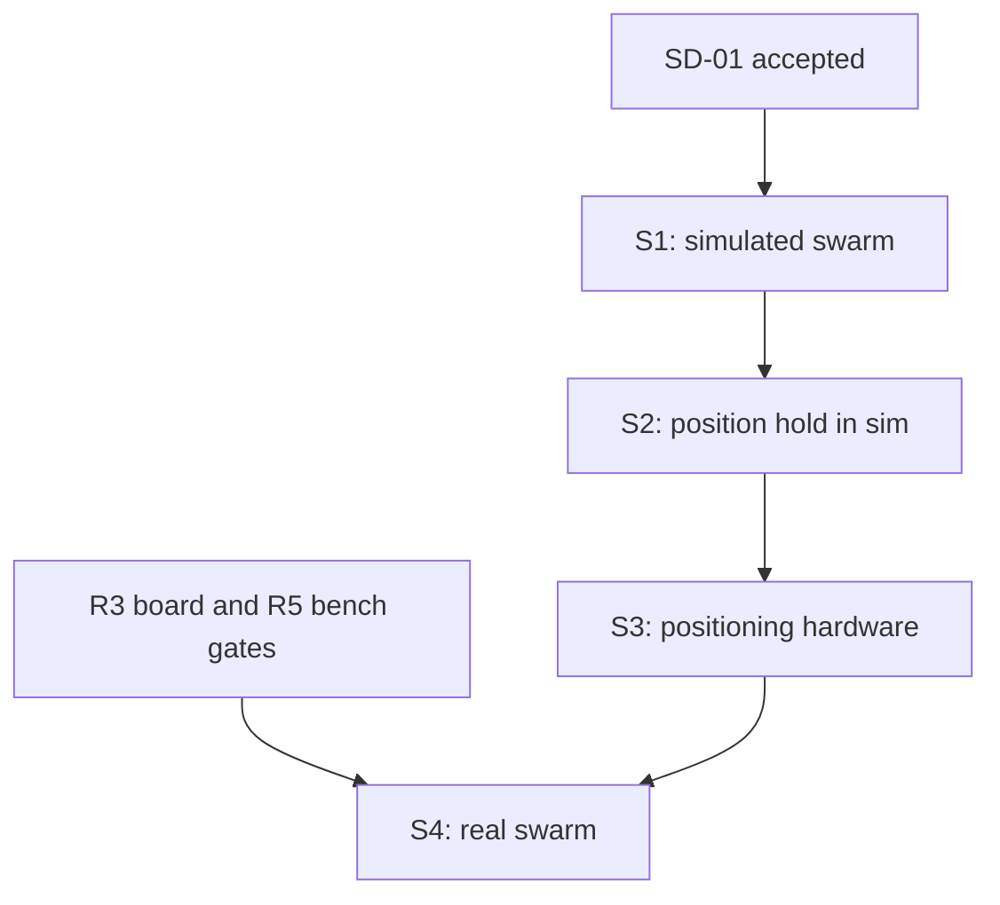

# Flix Swarm Flight Plan

Date: 2026-10-12, updated 2026-10-13. Status: **S1 done in simulation; S2 core in progress**; S3 and S4 not started. Requirements: [swarm specification](swarm-spec.md).

## In plain terms

1. **S1, practice in the computer.** Several simulated Flix drones, run by Crazyswarm2. No
   hardware and no money needed. Can start now.
2. **S2, teach the drone to hold a position.** New code in the drone, tested in simulation first.
3. **S3, give the drone a way to know where it is.** Buy and test a positioning system (UWB proposed).
4. **S4, test on real drones.** One first, then two, then more. Waits for the board kit (R3, R5).

## 1. Rules

The base plan's delivery rules apply: one runnable behaviour at a time, tests before integration,
evidence before claims, and open hardware gates stay open. Each stage closes with a gate result:
pass, fail, or waiting on a named prerequisite. Swarm work must not change existing tuning or
safety behaviour; if it needs to, that change gets its own justification and evidence.

## 2. S1: simulated swarm with Crazyswarm2

Deliverable: a Crazyswarm2 script flies three simulated Flix drones through a formation. Each
drone runs the real `Owner` and is commanded only through MAVLink AUTO attitude setpoints.

* [x] S1-01: Accept SD-01, SD-03 and SD-04, or revise them.
* [x] S1-02: Give each simulated drone its own system ID (SWM-01, SWM-11). First check whether a
  `PARAM_SET` of `MAV_SYS_ID` in Standby through `flix_receive` works. If not, add a versioned ABI
  call that creates an instance with a validated system ID. ABI tests cover duplicate, zero and
  out-of-range IDs.
* [x] S1-03: Confirm or change the 8-instance registry bound (SD-08). Test creation at the bound
  and the refusal above it.
* [x] S1-04: Add `adapters/crazyswarm2/` with the pinned upstream commit, a small patch that adds a
  `flix` controller option to `crazyflie_sil.py`, and a Python module that loads
  `libflight_gazebo` through `ctypes`.
* [x] S1-05: Add a Flix plant to the Crazyswarm2 simulator using the same mass, arm length, thrust
  and torque constants and motor asymmetry as the Gazebo plugin (`adapters/gazebo/plugin.cpp`).
  Record the source of every constant.
* [x] S1-06: Generate IMU samples from the simulated state: body-frame rates and specific force,
  with the same MPU6050 range limits as the Gazebo plugin. Call `flix_tick2` every second physics
  step (1 kHz, since Crazyswarm2 steps at 0.5 ms).
* [x] S1-07: Write the ground position loop: position target to attitude quaternion and thrust,
  with bounded tilt and thrust. Send it as `SET_ATTITUDE_TARGET` packets through `flix_receive`
  at a fixed rate shorter than the AUTO lease. Arm each drone with an explicit request (SWM-02).
* [x] S1-08: Add a Docker image (arm64, ROS 2 Jazzy, Crazyswarm2, our release library) that runs
  on Colima the same way the Gazebo image does.
* [x] S1-09: Scenarios and checks, each with a recorded trace:
  - one drone: takeoff, hover, `GoTo`, land;
  - three drones: formation change, minimum pair distance reported (SWM-12);
  - swarm stop: every drone's output reaches zero on the next tick (SWM-03);
  - one drone's setpoints stop: only that drone fails safe, the others continue (SWM-04);
  - one drone gets a sensor fault: only that drone stops (SWM-04);
  - one drone refuses to arm: the script reports it and does not fly that drone (SWM-02);
  - eight drones: setpoint rate and latency recorded (SWM-13).
* [x] S1-10: Add a CI job, or extend the gazebo job, that runs the three-drone scenario.

S1 notes (2026-10-13):
- S1-01: SD-01, SD-03 and SD-04 accepted.
- S1-02: no ABI change needed. Each owner is provisioned through `maintenance`, `PARAM_SET`
  `SF_RC_LOSS_TIME` (0.3 s) and `MAV_SYS_ID`, then `exit`; the ground waits for both `PARAM_VALUE`
  confirmations before the drone counts as ready.
- S1-03: the 8-owner bound is kept; the `load` scenario flies 8 drones and checks a ninth is refused.
- S1-04: `adapters/crazyswarm2/` with `ros/crazyflie_server.patch` against Crazyswarm2 `f1e0995`.
  The patch also adds `arm` services and a working `emergency`, which the stock simulator lacks.
- S1-06: `flix_tick2` runs every 1 ms physics step; the `flix` backend steps at 1 kHz instead of
  Crazyswarm2's 0.5 ms, with two 0.5 ms integrator substeps inside the plant.
- S1-09: the full list runs in the fast harness (`flix_swarm.scenarios`, on every push via
  `scripts/check.sh`). The Crazyswarm2 path runs formation, swarm stop and partial arming through
  stock `crazyflie_py` (`make swarm-sim`, CI job `swarm`).

Gate: all S1-09 scenarios pass in CI on the pinned images. Evidence goes in
`docs/rust-rewrite/evidence/swarm-s1/`. This proves coordination works with the real Flix control
and safety code. It says nothing about hardware or about on-board position control.

## 3. S2: position hold on the drone, in simulation

Deliverable: a simulated Flix drone holds and moves between positions with the position loop
running inside `flight-core`, fed by a simulated positioning system with noise, delay and dropouts.

* [x] S2-01: Close SD-02, SD-05, SD-06 and SD-09. Write the position contracts: units, world frame,
  flight volume, freshness limits.
* [x] S2-02: Add a validated position sample type and a source lease for it (SWM-05). Property
  tests cover non-finite values, out-of-volume values, stale and out-of-order samples.
* [x] S2-03: Add a position and velocity estimator that fuses accelerometer data with external
  position. It must be `no_std` with no allocation in the tick, and report its health and sample age.
* [x] S2-04: Add `Intent::Position` and the position controller on top of the existing attitude
  controller, with bounded tilt and thrust (SWM-06, SWM-08). Kani proofs cover output bounds.
* [x] S2-05: Add the failure response for lost position (SWM-07), with tests that fail if it is
  removed.
* [x] S2-06: Decode and encode the chosen messages, test frame conversion in both directions
  (SWM-10), and add fuzz targets.
* [x] S2-07: Simulate the positioning system in Gazebo and in Crazyswarm2 (noise, delay, rate,
  dropouts). Move the S1 ground loop onto the drone and rerun the S1 scenarios.

S2 notes (2026-10-13):
- S2-01: SD-02, SD-05, SD-06, SD-09 closed; SD-10 (takeoff into position control) and SD-11 (lost
  position stops) added. Contracts live in `crates/flight-core/src/position.rs`.
- S2-02: samples are rejected before any state change when non-finite, more than 0.5 m outside the
  volume, not newer than the last sample, or outside the owner's clock window. There is no separate
  source lease: freshness (200 ms) gates position control directly.
- S2-03: fixed-gain observer (alpha 0.3, beta 0.1 per sample) over IMU prediction; `no_std`, no
  allocation. Heading is the IMU estimate's: the external yaw is not fused yet, so the positioning
  frame and the drone's yaw must start aligned (open item for S3).
- S2-04: built-in `PositionTuning` constants, not operator parameters yet: new parameters change the
  persisted settings record and need a schema migration. The z integral gain is 6 so a wrong hover
  thrust guess (0.50 against about 0.54 in the plant) settles in about 5 s.
- S2-06: dialect gains 84 and 138 with CRCs and lengths from the pinned MAVLink 2.0.33 headers.
- S2-07: the fast harness runs all S1 scenarios plus `position-dropout`, `outside-volume` and
  `noisy` (2 cm noise, 20 ms latency) with `--onboard`; the Gazebo coordinator has `--onboard`.
- Not done yet: Kani proof of position controller output bounds; property tests over position
  samples; heading alignment; parameters; Crazyswarm2 (ROS) path in on-board mode.

Gate: S1 scenarios pass with the on-board loop; position dropout, out-of-volume setpoints and
stale samples produce the required response; `no_std`, Clippy, Kani and fuzz jobs pass.

## 4. S3: positioning hardware

* [ ] S3-01: Close SD-07. Record the exact parts, price and supplier, as the Bangladesh BOM does.
* [ ] S3-02: Bench-measure accuracy, update rate, latency and dropout behaviour in the planned test
  space, with the drone stopped.
* [ ] S3-03: Write the driver or ground tracker. Feed recorded positioning traces back into the S2
  simulator to check that the estimator handles real noise.

Gate: measured accuracy and latency meet the S2 assumptions, or the S2 limits are revised from the
measurements.

## 5. S4: real swarm flight

Requires R3 (board profile) and R5 (bench stop traces and timing) to pass first.

* [ ] S4-01: One drone, tethered or netted: position hold, measured stop on position loss and on
  link loss.
* [ ] S4-02: Measure link load and latency for N drones on the chosen radio; set lease durations
  (SWM-13).
* [ ] S4-03: Two drones, then more, inside a net, with the separation threshold from SD-09 and an
  operator stop that reaches every drone.

Gate: supervised flight evidence within a stated envelope, recorded per drone. Until then the
project claims no swarm flight capability.

## 6. Effort estimate

Rough sizing, for planning only: S1 about 3 to 5 days, S2 about 2 to 3 weeks, S3 depends on
parts arriving, S4 depends on R3 and R5.
