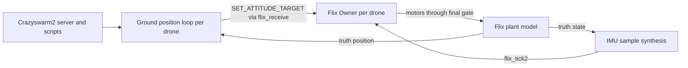
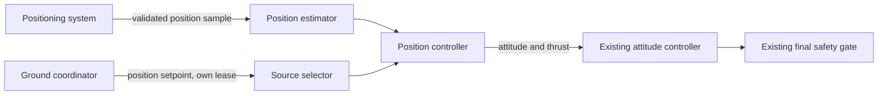

# Flix Swarm Flight Specification

Date: 2026-10-12. Status: **proposed, not accepted**. Nothing described here is implemented.
Delivery work: [swarm plan](swarm-plan.md). Base requirements: [Rust rewrite specification](rust-rewrite-spec.md).

## In plain terms

Today a Flix drone can keep itself level and turn the way a pilot tells it to. It does not know
where it is in the room, so it drifts when nobody steers. A swarm needs three things:

1. each drone knows where it is;
2. each drone can fly to and hold a point by itself;
3. one ground computer tells every drone where to go, so they do not collide.

[Crazyswarm2](https://github.com/IMRCLab/crazyswarm2) provides item 3 for Crazyflie drones. Flix
has none of the three yet. This document defines what each part must do and what keeps it safe.

## 1. Objective

Fly several Flix drones together on coordinated paths commanded by one ground computer, first in
simulation and later on hardware, without weakening any requirement of the base specification.
Swarm work adds capabilities; it does not relax SAF-01 to SAF-08.

## 2. Scope

| Stage | Delivers | Needs hardware |
| --- | --- | --- |
| S1 | Simulated swarm: Crazyswarm2 coordinates several simulated Flix drones running the real `Owner` | No |
| S2 | Position hold on the drone: external position input, position controller, position intent | No (sim first) |
| S3 | Positioning system chosen, integrated and measured | Yes |
| S4 | Real swarm flight: one drone, then two, then more | Yes, after R3 and R5 |

Out of scope: outdoor or GPS flight, drone-to-drone communication, on-board collision avoidance
between drones, autonomous navigation, new airframes. Base specification §11 lists position and
velocity as unsupported; that remains true until the S2 gate passes.

## 3. Current facts this builds on

Checked against `main` at `ccf1761`:

- `flight_core::control::Intent` has `Stabilized`, `Acro`, `Attitude` and `Rates`. There is no
  position or velocity intent and no position estimate.
- AUTO attitude already exists: MAVLink `SET_ATTITUDE_TARGET` (82) decodes to
  `Intent::Attitude` or `Intent::Rates` from `Source::Automatic` (`crates/flight-protocol/src/lib.rs`).
- Each drone has `MAV_SYS_ID` (1 to 255, default 1), and the protocol rejects packets addressed to
  another system ID.
- The Gazebo ABI creates each instance with `Owner::default()`, so every simulated drone starts
  with system ID 1. The registry holds at most 8 instances (`adapters/gazebo/src/lib.rs`).
- The simulator sends `calibrated = 1` IMU samples in the body frame, which skips `flight_esp32::imu`.
- Crazyswarm2 (pinned for evaluation at `f1e0995`, 2026-09-11) commands positions only:
  `Takeoff`, `Land`, `GoTo`, trajectories, `cmdFullState`. Its simulator steps physics every
  0.5 ms with Crazyflie mass and inertia, and runs Crazyflie firmware controllers through Python
  bindings (`crazyflie_sim/crazyflie_sil.py`).

## 4. Architecture

### S1: simulated swarm, position loop on the ground

S1 adds no position code to `flight-core`. The ground loop sends ordinary AUTO attitude setpoints
through the existing protocol path, so leases, arming and the final gate apply unchanged. Ground
truth stands in for a positioning system.

### S2 onward: position loop on the drone

The proposed design puts the position loop on the drone, because then Wi-Fi delay and packet loss
affect only setpoints, not the loop itself. Decision SD-02 records this.

## 5. Requirements

| ID | Requirement | Acceptance evidence |
| --- | --- | --- |
| SWM-01 | Each drone in a swarm has a unique system ID. A packet addressed to another drone changes nothing. | Protocol tests; sim run with mixed addressing |
| SWM-02 | The coordinator never arms a drone implicitly. Arming is a separate, explicit request per drone, checked against SAF-05. | Negative tests; sim scenario where one drone refuses to arm and the others proceed |
| SWM-03 | A swarm-wide stop reaches every drone's reserved stop path (SAF-04). Its delivery is not needed for safety: each drone also stops on its own when its lease expires. | Flood and broadcast-stop tests; per-drone output trace |
| SWM-04 | Losing one drone's link, sensor or position stops or fails safe only that drone and is reported to the coordinator. Other drones keep their own leases. | Sim fault injection per drone |
| SWM-05 | Position input is validated before use: finite, inside the configured flight volume, from the accepted source, fresh by local arrival time, and in order. Sender timestamps never extend freshness. Heartbeats never renew it. | Unit and property tests; fuzzing of the new message decoder |
| SWM-06 | Position control is selected by an explicit `Intent` variant with its own lease, using the same rules as AUTO. NaN cannot select it. | Type-level selection; property tests over all intents |
| SWM-07 | Stale or missing position while flying under position control never holds the last attitude command. Bench profile: stop. Flight profile: level and ramp thrust down (base §7), never described as a guaranteed landing. | Boundary-time tests; sim position dropout |
| SWM-08 | Position setpoints outside the configured flight volume are rejected. Position controller output is bounded in tilt and thrust and passes through the existing attitude path and final gate (SAF-02). | Property tests; attempted bypass tests |
| SWM-09 | The position estimator and controller stay `no_std`, allocate nothing in the tick, and have a measured execution bound. | `no_std` check, allocation test, target timing at S4 |
| SWM-10 | World frame and body frame are stated at every boundary. Body stays FLU. Any NED/ENU conversion happens at the protocol boundary and is tested in both directions. Motor order stays RL, RR, FR, FL. | Round-trip frame tests |
| SWM-11 | Every simulated drone owns its own `Owner`, settings, clock history and reset generation. The maximum instance count is fixed and a refused creation is reported. | ABI tests; sim run at the maximum count |
| SWM-12 | Collision safety comes from the plan and from stopping, not from drone-to-drone avoidance. The coordinator checks a minimum separation before sending a plan, and every sim run reports the minimum pair distance it saw. | Scenario reports with separation threshold |
| SWM-13 | Command traffic for N drones fits the link: the per-drone setpoint rate and observed latency are measured, and lease durations are chosen from those measurements. | Sim load test at S1; radio measurement at S4 |

## 6. Positioning options (S3)

| Option | Accuracy (typical) | Cost | Notes |
| --- | --- | --- | --- |
| UWB ranging (DW1000/DW3000 class) | about 10 cm | Low | Anchors in the room, one tag per drone. Adds a sensor driver and range fusion. Proposed. |
| Camera with markers | cm level when tracked | Low | Ground computer tracks markers. Light and occlusion sensitive. |
| Commercial motion capture | mm level | High | OptiTrack or Vicon. Most accurate, least affordable. |
| Optical flow and range sensor | drifts | Low | No shared world frame, so not enough for a swarm on its own. |

Accuracy figures are vendor-class expectations, not measurements. S3 measures them.

## 7. Decisions

| ID | Decision | Proposed position | Must close before |
| --- | --- | --- | --- |
| SD-01 | Adopt swarm flight as a project requirement | Proposed in this document | S1 starts |
| SD-02 | Where the position loop runs | Ground in S1 (sim only); on the drone from S2 | S2 starts |
| SD-03 | Coordinator | Crazyswarm2, pinned and kept outside the Cargo workspace; ROS 2 never enters the firmware or `flight-core` | S1 gate |
| SD-04 | Where the Crazyswarm2 integration lives | `adapters/crazyswarm2/` in this repository: Python SIL module, Flix plant parameters, Dockerfile, pinned upstream commit and a small patch; MIT notice kept | S1 starts |
| SD-05 | Position input message | Candidates `ATT_POS_MOCAP` (138) or `VISION_POSITION_ESTIMATE` (102) for ground-measured position; on-board driver if UWB tags measure locally | S2 protocol work |
| SD-06 | Position setpoint message | Candidate `SET_POSITION_TARGET_LOCAL_NED` (84) with a documented supported mask | S2 protocol work |
| SD-07 | Positioning system | UWB proposed; open | S3 starts |
| SD-08 | Maximum swarm size | 8 per simulator process (current registry); hardware count set by link measurements (SWM-13) | S1 gate, S4 |
| SD-09 | Flight volume and separation thresholds | Open; set per test space | S2 gate |

## 8. Verification

S1 and S2 produce host and simulation evidence only. They do not show that hardware can fly a
swarm. S3 and S4 require measured positioning accuracy, latency and dropout behaviour, measured
stop traces per drone, and supervised flight inside a net or enclosure. Evidence goes under
`docs/rust-rewrite/evidence/swarm-<stage>/` with the fields listed in `AGENTS.md`.
